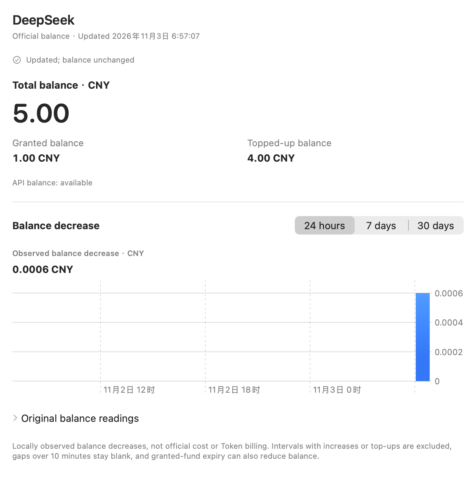
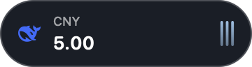

<p align="center">English · <a href="README.zh-CN.md">简体中文</a></p>

<h1 align="center">ReadyCheck</h1>
<p align="center"><strong>Codex quotas. DeepSeek balances. One quiet place.</strong></p>
<p align="center">A free, open-source macOS monitor with a menu bar, floating capsule and notch view.</p>
<p align="center"><a href="https://github.com/whnnick/readycheck/tree/v0.7.0-dev.28"></a> <a href="docs/INSTALL.md"></a> <a href="LICENSE"></a></p>
<p align="center"><a href="#quick-start">Quick start</a> · <a href="docs/versions/0.7.0/RELEASE_NOTES.md#source-candidate-dev28">Current changes</a> · <a href="docs/versions/0.7.0/QA.md">Checks &amp; limits</a> · <a href="docs/VERSIONS.md">Versions</a></p>

## Choose your version

| Channel | Version | Get it |
| --- | --- | --- |
| **Latest source / packaged candidate** | **0.7.0-dev.28** | [Source tag](https://github.com/whnnick/readycheck/tree/v0.7.0-dev.28) · [Changes and package checksums](docs/versions/0.7.0/QA.md) |
| **Latest downloadable preview** | **0.7.0-dev.23** | [Mac DMG](https://github.com/whnnick/readycheck/releases/download/v0.7.0-dev.23/ReadyCheck-0.7.0-dev.23-macos.dmg) · [Windows ZIP](https://github.com/whnnick/readycheck/releases/download/v0.7.0-dev.23/ReadyCheck-0.7.0-dev.23-windows-x64-portable.zip) |
| Stable release channel | 0.6.1 | [Mac DMG](https://github.com/whnnick/readycheck/releases/download/v0.6.1/ReadyCheck-0.6.1-macos.dmg) · [Windows ZIP](https://github.com/whnnick/readycheck/releases/download/v0.6.1/ReadyCheck-0.6.1-windows-x64-portable.zip) |

Dev.28 packages and source/tag are verified, but **dev.28 has no public GitHub Release or hosted installer assets**. The preview download links above intentionally remain dev.23. Features and screenshots below describe current dev.28 source; [preview differences](docs/versions/0.7.0/RELEASE_NOTES.md#public-preview-dev23) and [release limits](docs/versions/0.7.0/QA.md) are documented.

<p align="center"></p>
<p align="center"><sub>Current dev.28 native balance component. All screenshots use synthetic data, not a real account.</sub></p>

## What you can see

| | Codex | DeepSeek API |
| --- | --- | --- |
| Connection | ReadyCheck OAuth sign-in | API Key, stored separately |
| Current reading | Returned quota windows, reset times and availability | Official balance by currency, with granted and topped-up components |
| History | Local quota decreases and returned daily Token statistics | Locally observed balance decreases; gaps stay unknown |
| Account details | Plan, subscription, Credits and reset-card records; expanded by default | API-balance availability and last successful read |
| Reminders | Low quota, observed recovery and card-expiry milestones | Explicitly enabled balance thresholds, scoped to connection/currency |

**Two supported connections.** The ten-service catalog also lists future integrations; the other eight are not connected or advertised as readable. See [implementation scope](docs/versions/0.7.0/TECHNICAL.md).

## Stay small while you work

<table>
<tr><th>Capsule and edge strip</th><th>Balance details</th></tr>
<tr><td align="center"><br></td><td align="center"></td></tr>
</table>

- **One shared interaction.** Hover or ordinary-click a capsule to preview. Only the explicit pin button keeps details open; content clicks preserve that choice. Pinning is separate from window always-on-top.
- **Your preferred surface.** Use the menu bar, capsule/edge strip, information card or click-to-expand notch. Saved positions and the existing display controls remain available.
- **Clearer account information.** Benefits open by default. Inspect recorded card outcomes separately from notification delivery.
- **Fewer repeated warnings.** An already reported card incident is not resubmitted after credential recovery or restart; genuinely new incidents remain eligible.
- **Optional card use.** Account-specific consent is required for an eligible expiring-card attempt. This is separate from read-only refresh and expiry reminders. [Rules](docs/versions/0.3.0/RESET_CARD_AUTOMATION.md).

## Keep the units honest

- **Quota:** remaining percentages and locally observed decreases in percentage points. A drop from 80% to 70% is 10 points, not a Token count.
- **Tokens:** returned Codex counts grouped by UTC day; there is no fixed conversion from quota percentages.
- **Balance:** currency amounts. Local decreases are observations, not an official expense or Token bill; credits, refunds and grant expiry can affect balances. No percentage bar implies a balance limit.

Missing samples stay blank. Old/failed readings retain their status and original time instead of becoming a fresh zero. History is isolated by account or connection; unknown legacy ownership stays separate.

## Quick start

1. Download a **Mac preview DMG** above, open it and copy ReadyCheck.app to Applications.
2. In **Settings → Connection**, sign in to Codex or select DeepSeek and enter your Key in the app. Approve normal macOS Keychain prompts if needed.
3. Choose your surface under **Settings → Display**. Configure reminders separately under **Settings → Reminders**.

[Mac installation and upgrades](docs/INSTALL.md) · [Windows guide](docs/WINDOWS.md)

## Platforms and verification

| Platform | Current scope |
| --- | --- |
| **macOS / Apple silicon / 14+** | Codex + DeepSeek native client. Dev.28 has **517 passing checks**, installed core-flow acceptance and a [65-item retention matrix](docs/versions/0.7.0/RELEASE_AUDIT.md). Mac packages use the existing self-signed preview identity; they are not Developer ID signed or notarized. |
| **Windows x64** | Separate Electron Codex client and portable ZIP. It retains its existing interface and does not include the Mac DeepSeek/notch features. Packaging/check/smoke/UI-smoke passed; the reported Windows OAuth 403 and hardware acceptance remain pending. [Windows QA](docs/WINDOWS_QA.md). |

Other accounts, all display/Spaces/fullscreen combinations, OS login and every live reminder boundary are not comprehensively accepted. Current evidence and release gates are recorded in [black-box checks](docs/versions/0.7.0/QA.md).

## Privacy

Normal refresh reads authorized provider data without model-generation calls. Mac credentials stay in Keychain; Windows uses Electron safeStorage. DeepSeek credentials are independent from Codex, and local histories retain identity boundaries. Do not share keys, OAuth callback URLs or raw account payloads in issues or screenshots.

ReadyCheck does not automatically stop or resume Codex tasks. Optional card redemption requires separate consent. ReadyCheck is independent of OpenAI and DeepSeek; their names and marks belong to their owners.

## Build and contribute

macOS source requires a Swift 6-compatible toolchain and macOS 14+:

```bash
swift test
scripts/build_and_run.sh
```

For distributable artifacts use the [release process](docs/RELEASE.md); Windows builds use Node.js 22.12–24 and the existing packaging script. See [contributing](CONTRIBUTING.md) and [security](SECURITY.md).

[Current plan](docs/versions/0.7.0/PLAN.md) · [Technical scope](docs/versions/0.7.0/TECHNICAL.md) · [Changelog](CHANGELOG.md) · [Version archive](docs/VERSIONS.md) · [Issues](https://github.com/whnnick/readycheck/issues) · [MIT license](LICENSE)
