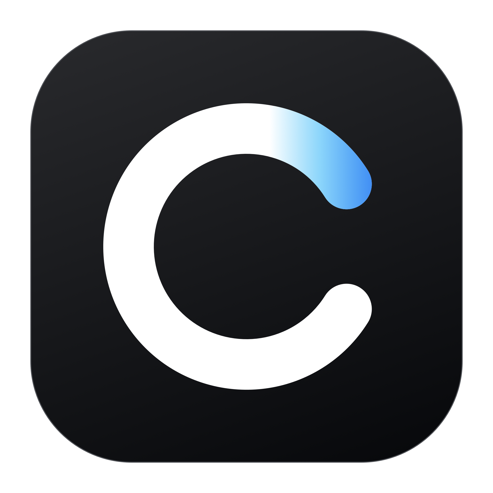
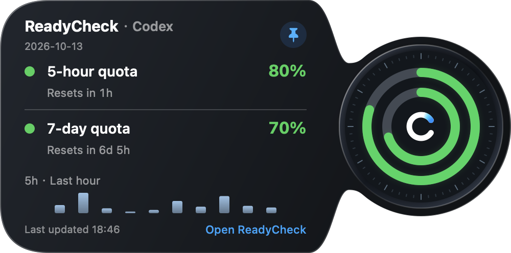
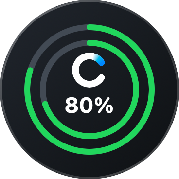

<p align="center">
  
</p>
<h1 align="center">ReadyCheck</h1>
<p align="center"><strong>Keep Codex quota in view while you work.</strong></p>
<p align="center">English · <a href="README.zh-CN.md">简体中文</a></p>
<p align="center">
  <a href="https://github.com/whnnick/readycheck/releases/latest"></a>
  <a href="docs/INSTALL.md"></a>
  <a href="LICENSE"></a>
</p>
<p align="center">
  <a href="https://github.com/whnnick/readycheck/releases/latest"><strong>Download</strong></a> ·
  <a href="docs/INSTALL.md">Setup</a> ·
  <a href="https://www.youtube.com/shorts/bb5wakVj4Do">33-second demo</a> ·
  <a href="docs/VERSIONS.md">Versions &amp; acceptance</a>
</p>

ReadyCheck is a free, open-source quota monitor for Mac users working with Codex. A small desktop bubble keeps remaining quota and reset times nearby, so you can check them without switching pages. Refreshing only reads authorized usage data; it does not send model inference requests.

<p align="center">
  
</p>
<p align="center"><sub>Native macOS UI from 0.1.145 · Synthetic demo data · Actual quota windows depend on your account.</sub></p>

## Start here

1. Download the macOS DMG from the [latest release](https://github.com/whnnick/readycheck/releases/latest), then drag ReadyCheck.app to Applications.
2. Launch ReadyCheck and use the signed-in local Codex account, or sign in separately with OAuth.
3. Enable the desktop widget. Hover to preview, click to keep details open, and drag the dial directly between the desktop and either screen edge.

The current macOS DMG is **arm64 for Apple silicon, macOS 14+**. It uses stable preview signing and is not Developer ID signed or notarized; see the [install guide](docs/INSTALL.md). Windows users can download the x64 portable ZIP from the same release page; unzip it and run ReadyCheck.exe.

## Small when you need it

<table>
  <tr>
    <th>Desktop bubble</th>
    <th>Edge tab</th>
  </tr>
  <tr>
    <td align="center"></td>
    <td align="center"></td>
  </tr>
  <tr>
    <td>Read the remaining percentage at a glance.</td>
    <td>Park it at an edge, then drag it directly inward.</td>
  </tr>
</table>

Pinned details stay open across outside clicks and focus changes. Unpinning restores hover preview; Esc dismisses focused details manually. The pin controls persistence independently from the always-on-top setting.

## What you can check

- **Quota and resets:** the validated windows your account returns, their remaining percentages and reset countdowns. Credits are shown when the authorized response provides them.
- **Usage history:** official account Token activity from the matching local Codex app-server when available. Otherwise, local quota decreases are clearly labelled as percentage points, not Tokens.
- **Timely reminders:** low-quota and verified recovery alerts while ReadyCheck runs, plus reminders for unused reset credits approaching expiration.
- **Your preferred surface:** the main window, menu bar, draggable bubble/card/edge styles, and an optional notch strip on supported Mac displays. Chinese and English are built in.

Unavailable or unverified data is shown as unavailable rather than an estimated percentage. Recovery reminders require fresh verified readings; an unobserved recovery while the app was closed is not replayed.

| Platform | Current scope |
| --- | --- |
| macOS | Native interface, widgets, notch strip and notification workflow. See [real-world QA](docs/QA.md) and [0.1.145 acceptance](docs/versions/0.1.145/QA.md) for tested conditions and remaining checks. |
| Windows x64 | Separate portable preview. The recent native bubble/pin/edge changes are macOS-only. See the [Windows plan](docs/WINDOWS.md) and [Windows acceptance](docs/WINDOWS_QA.md) for its actual scope. |

## Privacy and account access

Quota access is read-only. You can follow the local signed-in Codex account or use separate OAuth; macOS OAuth credentials are stored in the system Keychain. ReadyCheck does not need to send prompts or run model inference to refresh quota. Remove account details and credentials before posting logs or screenshots in an issue.

ReadyCheck is an independent project, not affiliated with or endorsed by OpenAI. Codex, ChatGPT and their marks belong to OpenAI.

## Documentation and development

| Start with | Details |
| --- | --- |
| [Install guide](docs/INSTALL.md) | Setup, platform requirements and preview-signing notes |
| [Version index](docs/VERSIONS.md) · [Changelog](CHANGELOG.md) | Requirements, black-box acceptance and release history |
| [Latest acceptance](docs/versions/0.1.145/QA.md) | Native edge repair, test evidence and coverage limits |
| [Real-world QA](docs/QA.md) | Practical installation and interaction checks |
| [Contributing](CONTRIBUTING.md) · [Release process](docs/RELEASE.md) | Development and distribution workflow |
| [Security policy](SECURITY.md) · [GitHub Issues](https://github.com/whnnick/readycheck/issues) | Security reports, defects and feedback |

Source builds require macOS 14+ and a Swift 6-compatible toolchain:

```bash
swift test
scripts/package_app.sh
```

For a development GUI launch, use `scripts/build_and_run.sh`. For release packaging, follow [the documented flow](docs/RELEASE.md). The current scripts name the macOS output `ReadyCheck-0.1.145-macos.dmg` and the Windows output `ReadyCheck-0.1.145-windows-x64-portable.zip`.

Licensed under [MIT](LICENSE).
