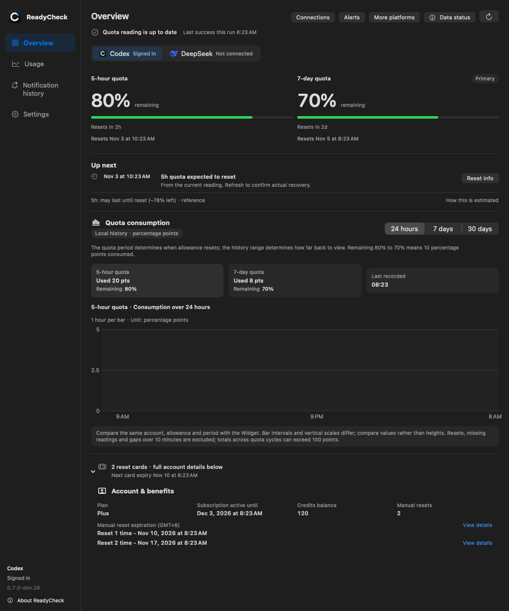
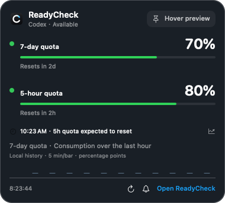
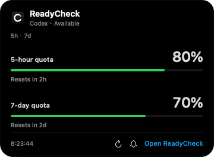
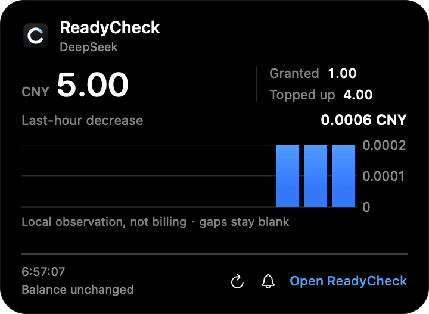

<p align="center">English · <a href="README.zh-CN.md">简体中文</a></p>

<h1 align="center">ReadyCheck</h1>
<p align="center"><strong>Know your Codex quota. See when it resets.</strong></p>
<p align="center">A lightweight, free, open-source Codex monitor for quotas, Token usage, account benefits and reminders.</p>
<p align="center"><a href="https://github.com/whnnick/readycheck/tree/v0.7.0-dev.28"></a> <a href="docs/INSTALL.md"></a> <a href="LICENSE"></a></p>
<p align="center"><a href="#quick-start">Quick start</a> · <a href="docs/versions/0.7.0/RELEASE_NOTES.md#source-candidate-dev28">Current changes</a> · <a href="docs/versions/0.7.0/QA.md">Checks &amp; limits</a> · <a href="docs/VERSIONS.md">Versions</a></p>

## Choose your version

| Channel | Version | Get it |
| --- | --- | --- |
| **Latest source / packaged candidate** | **0.7.0-dev.28** | [Source tag](https://github.com/whnnick/readycheck/tree/v0.7.0-dev.28) · [Changes and package checksums](docs/versions/0.7.0/QA.md) |
| **Latest downloadable preview** | **0.7.0-dev.23** | [Mac DMG](https://github.com/whnnick/readycheck/releases/download/v0.7.0-dev.23/ReadyCheck-0.7.0-dev.23-macos.dmg) · [Windows ZIP](https://github.com/whnnick/readycheck/releases/download/v0.7.0-dev.23/ReadyCheck-0.7.0-dev.23-windows-x64-portable.zip) |
| Stable release channel | 0.6.1 | [Mac DMG](https://github.com/whnnick/readycheck/releases/download/v0.6.1/ReadyCheck-0.6.1-macos.dmg) · [Windows ZIP](https://github.com/whnnick/readycheck/releases/download/v0.6.1/ReadyCheck-0.6.1-windows-x64-portable.zip) |

Dev.28 packages and source/tag are verified, but **dev.28 has no public GitHub Release or hosted installer assets**. The preview download links above intentionally remain dev.23. Features and screenshots below describe current dev.28 source; [preview differences](docs/versions/0.7.0/RELEASE_NOTES.md#public-preview-dev23) and [release limits](docs/versions/0.7.0/QA.md) are documented.

<p align="center"></p>
<p align="center"><sub>Current dev.28 Codex interface. All screenshots use synthetic data, not a real account.</sub></p>

## Built around everyday Codex use

| Your question | What ReadyCheck shows |
| --- | --- |
| How much can I still use? | The 5-hour, 7-day and other returned quota windows, remaining percentages and availability. |
| When does it recover? | Reset times and countdowns, upcoming events and usage pace based on current-cycle local samples, with an explicit explanation when samples are insufficient. |
| What have I used recently? | Locally observed quota decreases in Overview and returned daily Token counts in Usage, with history ranges and bar hover details. |
| What comes with my account? | Plan, subscription expiry, Credits, reset-card counts and expiry records. Account benefits open by default and can still be collapsed. |
| When should I pay attention? | Low-quota, observed-recovery and card-expiry reminders, plus notification history. Recovered credential warnings are withdrawn; the same reported card incident does not repeatedly alert. |
| Will it use a reset card? | Optional expiring-card attempts require separate account-specific consent, independent from read-only refresh and expiry reminders. [Card rules](docs/versions/0.3.0/RESET_CARD_AUTOMATION.md). |

Account fields depend on returned data; missing values are not invented. ReadyCheck does not automatically stop or resume Codex tasks.

## Keep Codex in view without keeping a window open

<table>
<tr><th>Codex floating capsule</th><th>Codex notch details</th></tr>
<tr><td align="center"></td><td align="center"></td></tr>
</table>

- **Choose your surface.** Menu bar, floating capsule/edge strip, information card or click-to-expand notch, with saved positions and display controls.
- **Expand when needed.** Hover or ordinary-click a capsule to preview. The explicit pin button keeps it open; content clicks preserve that choice. Pinning is separate from window always-on-top.
- **Return to the details.** Refresh, inspect reminders or open ReadyCheck from the small view to review quota, history and account benefits.

## Also supported: DeepSeek API balances

The Mac client also supports a separate DeepSeek API Key connection: official balances by currency, granted/topped-up components, last successful reads and locally observed balance decreases. Balance capsule, edge and notch layouts are available. Balance-threshold reminders are explicitly enabled and scoped to connection and currency.

<p align="center"></p>

**Codex and DeepSeek are the two supported connections.** The other eight entries in the ten-service catalog are future integrations, not connected services. See [implementation scope](docs/versions/0.7.0/TECHNICAL.md).

## Keep the units honest

- **Quota:** remaining percentages and locally observed decreases in percentage points. A drop from 80% to 70% is 10 points, not a Token count.
- **Tokens:** returned Codex counts grouped by UTC day; there is no fixed conversion from quota percentages.
- **Balance:** currency amounts. Local decreases are observations, not an official expense or Token bill; credits, refunds and grant expiry can affect balances. No percentage bar implies a balance limit.

Missing samples stay blank. Old/failed readings retain their status and original time instead of becoming a fresh zero. History is isolated by account or connection; unknown legacy ownership stays separate.

## Quick start

1. Download a **Mac preview DMG** above, open it and copy ReadyCheck.app to Applications.
2. In **Settings → Connection**, sign in to Codex and approve normal macOS Keychain prompts if needed. DeepSeek users can add an API Key connection separately.
3. Choose your surface under **Settings → Display**. Configure reminders separately under **Settings → Reminders**.

[Mac installation and upgrades](docs/INSTALL.md) · [Windows guide](docs/WINDOWS.md)

## Platforms and verification

| Platform | Current scope |
| --- | --- |
| **macOS / Apple silicon / 14+** | Codex + DeepSeek native client. Dev.28 has **517 passing checks**, installed core-flow acceptance and a [65-item retention matrix](docs/versions/0.7.0/RELEASE_AUDIT.md). Mac packages use the existing self-signed preview identity; they are not Developer ID signed or notarized. |
| **Windows x64** | Separate Electron Codex client and portable ZIP. It retains its existing interface and does not include the Mac DeepSeek/notch features. Packaging/check/smoke/UI-smoke passed; the reported Windows OAuth 403 and hardware acceptance remain pending. [Windows QA](docs/WINDOWS_QA.md). |

Other accounts, all display/Spaces/fullscreen combinations, OS login and every live reminder boundary are not comprehensively accepted. Current evidence and release gates are recorded in [black-box checks](docs/versions/0.7.0/QA.md).

## Privacy

Normal refresh reads authorized provider data without model-generation calls. Mac credentials stay in Keychain; Windows uses Electron safeStorage. DeepSeek credentials are independent from Codex, and local histories retain identity boundaries. Do not share keys, OAuth callback URLs or raw account payloads in issues or screenshots.

ReadyCheck does not automatically stop or resume Codex tasks. Optional card redemption requires separate consent. ReadyCheck is independent of OpenAI and DeepSeek; their names and marks belong to their owners.

## Build and contribute

macOS source requires a Swift 6-compatible toolchain and macOS 14+:

```bash
swift test
scripts/build_and_run.sh
```

For distributable artifacts use the [release process](docs/RELEASE.md); Windows builds use Node.js 22.12–24 and the existing packaging script. See [contributing](CONTRIBUTING.md) and [security](SECURITY.md).

[Current plan](docs/versions/0.7.0/PLAN.md) · [Technical scope](docs/versions/0.7.0/TECHNICAL.md) · [Changelog](CHANGELOG.md) · [Version archive](docs/VERSIONS.md) · [Issues](https://github.com/whnnick/readycheck/issues) · [MIT license](LICENSE)
