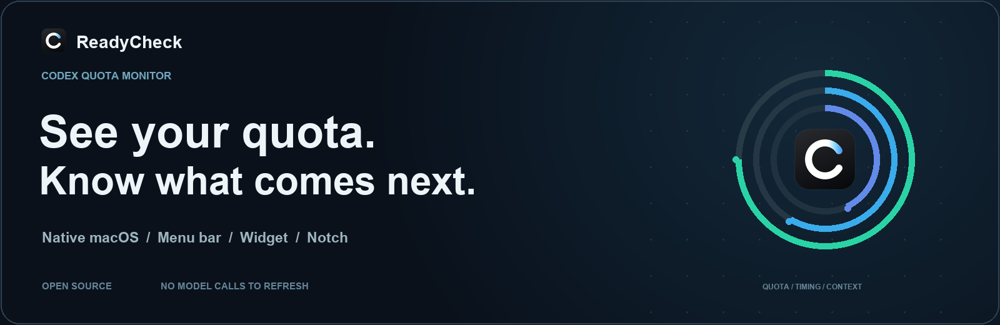
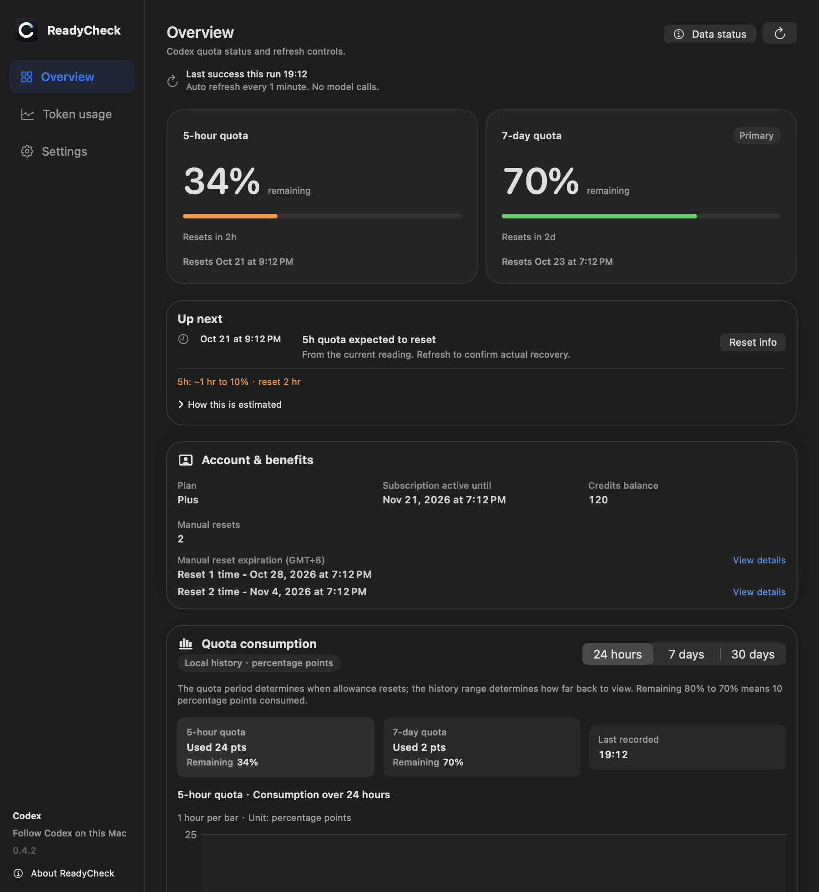
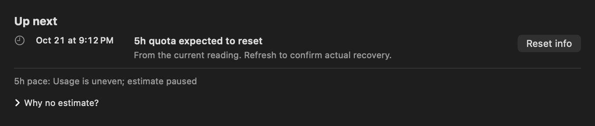
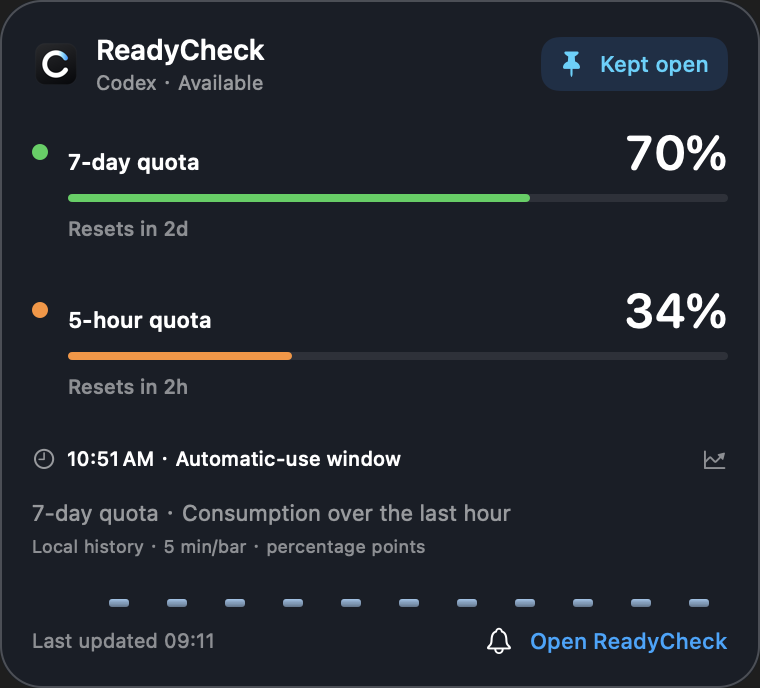
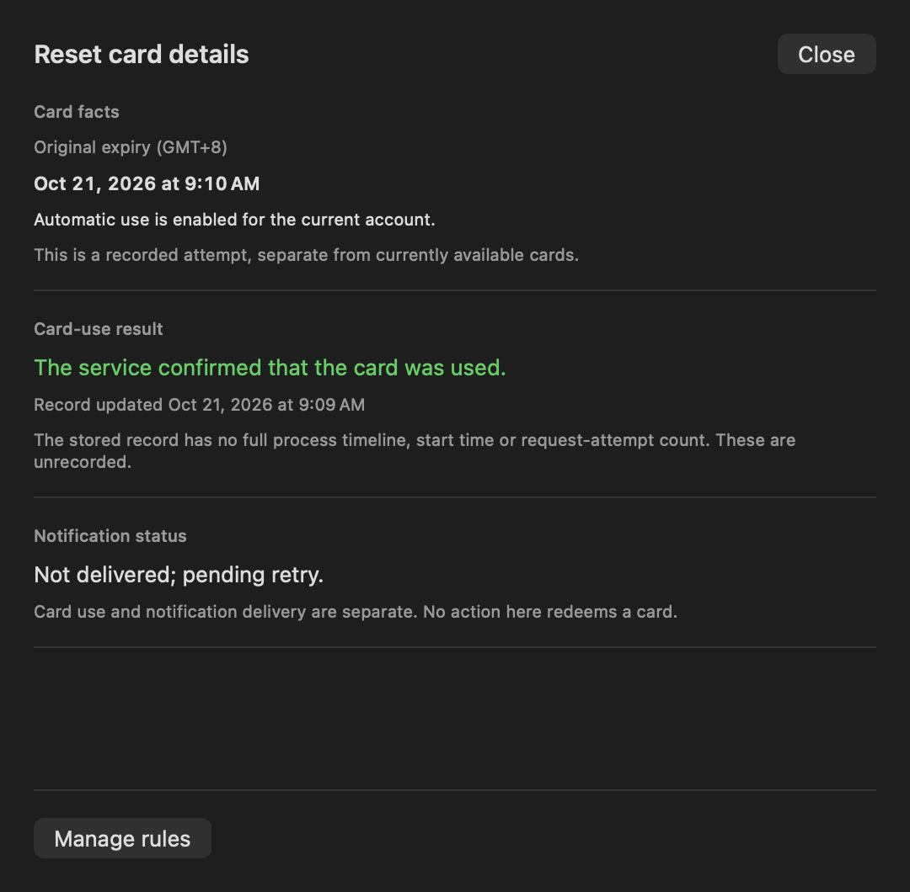

<p align="center">English · <a href="README.zh-CN.md">简体中文</a></p>

<h1 align="center">ReadyCheck</h1>
<p align="center"><strong>See your quota. Know what comes next.</strong></p>
<p align="center">A free, open-source Codex quota monitor, built for your Mac.</p>
<p align="center"><a href="https://github.com/whnnick/readycheck/releases/tag/v0.4.2"></a> <a href="docs/INSTALL.md"></a> <a href="LICENSE"></a></p>
<p align="center"><a href="https://github.com/whnnick/readycheck/releases/download/v0.4.2/ReadyCheck-0.4.2-macos.dmg"><strong>↓ Download for Mac</strong></a> &nbsp; · &nbsp; <a href="https://github.com/whnnick/readycheck/releases/download/v0.4.2/ReadyCheck-0.4.2-windows-x64-portable.zip">Windows portable</a></p>
<p align="center"><a href="docs/versions/0.4.2/RELEASE_NOTES.md">What's new</a> · <a href="docs/INSTALL.md">Install guide</a> · <a href="docs/versions/0.4.2/QA.md">Checks &amp; limits</a> · <a href="docs/VERSIONS.md">All versions</a></p>

<p align="center"></p>

## Start here

1. Download the **Mac DMG** above and drag ReadyCheck.app to Applications.
2. Follow your signed-in local Codex account, or sign in separately with OAuth. Approve Keychain access if macOS asks.
3. Choose thresholds in **Settings → Reminders**. Enable the Widget or notch in **Settings → Display**.

**Mac:** Apple silicon / arm64, macOS 14+. Stable **self-signed preview**, **not Developer ID signed or notarized**; read the [install guide](docs/INSTALL.md) before opening. **Windows:** unzip the portable x64 package and run ReadyCheck.exe; it retains its previous interface.

## Beyond a remaining percentage

| Know where you stand | Know what comes next | Keep your workspace yours |
| :--- | :--- | :--- |
| Both **5-hour and 7-day quotas**, exact reset times, account benefits and local consumption. | One shared next event across Overview, menu and Widget: reset, conditional card-use window or an issue needing attention. | A native window, menu bar, adaptive Widget and click-to-open notch. Use the surface that fits your work. |

<p align="center"></p>
<p align="center"><sub>Real native interface with synthetic data. This 0.4.2 capture shows explicit actions and a single layer of explanation.</sub></p>

### 0.4.2 — clear actions, one layer of explanation

**No ambiguous arrow. No nested explanation.** Up next uses named buttons for reset information, connection or details. Usage pace shows one conclusion; one click reveals its reason. Menu and Widget open the complete explanation directly.

<p align="center"></p>

[Release notes](docs/versions/0.4.2/RELEASE_NOTES.md) · [Verification and limits](docs/versions/0.4.2/QA.md). Calculation rules, reminders, card-use authorization and history are retained.

## Small when working. Detailed when needed.

<table>
<tr><th>Keep an eye on the last hour</th><th>Understand the card result</th></tr>
<tr><td align="center"></td><td align="center"></td></tr>
<tr><td>The Widget keeps both quotas, the next event and the <strong>last-hour chart</strong> together. Pin it when you need it; tuck it away when you don't.</td><td>Inspect the original expiry, account authorization, recorded outcome and its matching notification. Notification delivery and card redemption are separate results.</td></tr>
</table>

<p align="center"><sub>Native 0.4.0 captures with synthetic data; these features remain in 0.4.2.</sub></p>

- **One adaptive Widget.** Drag the bubble to either edge for a slim strip, or inward for the bubble. Choose an information card and drag its title. Pinned details stay open across outside clicks and focus changes; unpin to restore preview behavior. Esc dismisses focused details.
- **A quieter notch.** Click to expand; click outside or press Esc to dismiss. Hovering alone does not open it.
- **Account benefits stay visible.** Plan, subscription validity, Credits, reset-card count and individual expiry dates remain, alongside read-only card records and About.
- **Less repetition at expiry.** Once macOS accepts a reminder, the same card/milestone is not resubmitted; later72/48/24/12-hour nodes remain independent. Explicit submission failures can retry, and submitted/verified delivery are recorded separately.
- **Separate reminder controls.** Low quota, recovery and reset-card expiry have independent controls. Expiry reminders are on by default; optional automatic card use is off by default and requires account-specific consent.
- **Optional expiring-card use.** When authorized and conditions permit, attempt a qualifying card in its final hour. Confirmed success has its own notification and history record, independent of the expiry-reminder toggle. [Automation rules](docs/versions/0.3.0/RESET_CARD_AUTOMATION.md).

## Three views. Two different measurements.

| View | What it shows | Source |
| --- | --- | --- |
| Widget → Quota consumption | Last hour of the selected quota; **5 minutes per bar**, in percentage points. | Successful local refresh samples for the current account. |
| Overview → Quota consumption | Same metric over **24 hours / 7 days / 30 days**; one hour / six hours / one day per bar. | The same local history and decrease rule as Widget. |
| Token usage → Daily Token counts | Returned Token counts, grouped by **UTC day**. | Official matching-account Codex statistics, when available. |

**80% → 70% means 10 percentage points consumed.** It does not mean 10 Tokens, or 10% of the original 80%. Local history excludes reset changes, invalid/missing readings, increases and gaps over ten minutes. Consumption across cycles can exceed 100 points. Widget bars scale to their own maximum. There is **no fixed conversion** to Tokens; missing Token data is never replaced by a second quota chart. Pace estimates are conditional references, not promises of available work time.

## Clear boundaries, by design

| Platform | Release scope |
| --- | --- |
| **macOS** | Native Overview/menu, shared next events, card records, adaptive Widget, last-hour chart, movable card, click-only notch and account/history features. [0.4.1 checks](docs/versions/0.4.2/QA.md) · [65-feature retention audit](docs/versions/0.4.0/RELEASE_AUDIT.md). |
| **Windows x64** | Separate portable preview with its previous interface. The Mac redesign and this Mac notification fix are not claimed for Windows. [Windows guide](docs/WINDOWS.md) · [Checks](docs/WINDOWS_QA.md). |

ReadyCheck **does not automatically stop or resume Codex tasks**. Reset timestamps need fresh readings to confirm recovery; unobserved recovery while closed is not replayed. Real card redemption, another live account, multi-display/Spaces, Focus/sleep, VoiceOver and Windows hardware are not claimed comprehensively verified; consult the version checks for the actual coverage.

## Privacy and account access

Refreshing reads authorized usage data **without model-generation requests**. Quota refresh is read-only; optional card redemption is a separately authorized mutation. Follow the local Codex account or use separate OAuth; Mac OAuth credentials stay in Keychain. History is account-scoped, and unknown legacy ownership is kept separate. Remove credentials and account details before sharing logs or screenshots.

ReadyCheck is independent and is not affiliated with or endorsed by OpenAI. Codex, ChatGPT and their marks belong to OpenAI.

## Documentation and development

[Install](docs/INSTALL.md) · [Changelog](CHANGELOG.md) · [Versions](docs/VERSIONS.md) · [Contributing](CONTRIBUTING.md) · [Release process](docs/RELEASE.md) · [Security](SECURITY.md) · [Issues](https://github.com/whnnick/readycheck/issues)

Source builds require macOS 14+ and a Swift 6-compatible toolchain:

```bash
swift test
scripts/package_app.sh
```

Use `scripts/build_and_run.sh` for development; follow the release process for distribution. Licensed under [MIT](LICENSE).


<details>
<summary>Product plans, previous designs and feature-retention records</summary>

- **0.4.2:** [Release notes](docs/versions/0.4.2/RELEASE_NOTES.md) · [Checks](docs/versions/0.4.2/QA.md) · [Retention](docs/versions/0.4.2/RELEASE_AUDIT.md).
- **0.4.1:** [Plan](docs/versions/0.4.1/PLAN.md) · [Checks](docs/versions/0.4.1/QA.md).
- **0.4.0:** [Plan](docs/versions/0.4.0/PLAN.md) · [Native contract](docs/versions/0.4.0/TECHNICAL.md) · [Release notes](docs/versions/0.4.0/RELEASE_NOTES.md) · [Checks](docs/versions/0.4.0/QA.md) · [Retention audit](docs/versions/0.4.0/RELEASE_AUDIT.md) · [Design prototype archive](docs/versions/0.4.0/prototype/README.md).
- **0.3.0:** [65-feature retention baseline](docs/versions/0.3.0/FEATURE_RETENTION.md) · [Plan and limits](docs/versions/0.3.0/PLAN.md) · [Native contract](docs/versions/0.3.0/TECHNICAL.md) · [Quota-pace prototype](docs/versions/0.3.0/prototype/README.md). Prototype omissions do not authorize removing features.
- **0.2.2:** [Connection reliability](docs/versions/0.2.2/PLAN.md) · [Checks](docs/versions/0.2.2/QA.md); included in 0.3.0.
- **0.2.1:** [Plan](docs/versions/0.2.1/PLAN.md) · [Checks](docs/versions/0.2.1/QA.md).
- **0.2.0:** [Plan](docs/versions/0.2.0/PLAN.md) · [Upgrade review](docs/versions/0.2.0/UPGRADE_REVIEW.md) · [Black-box checks](docs/versions/0.2.0/QA.md).

</details>
