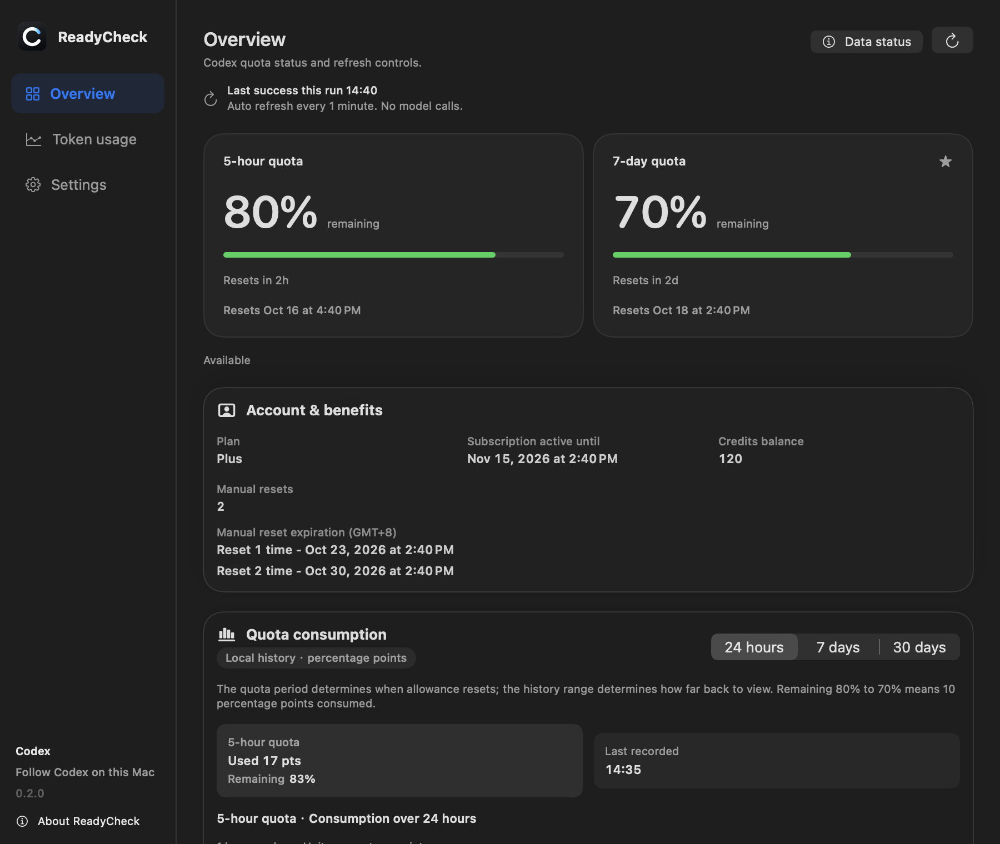
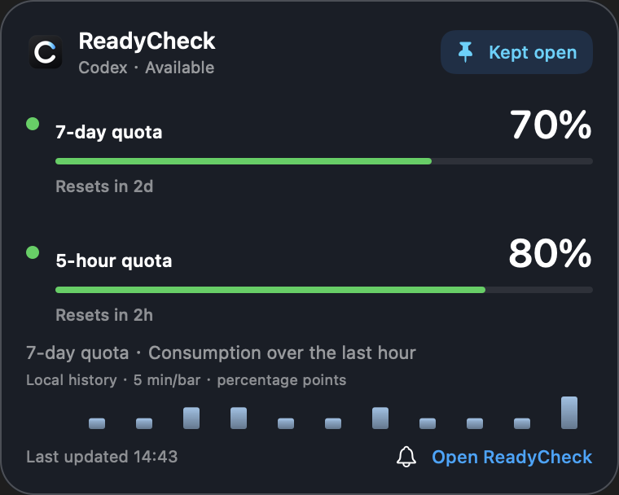

English · [简体中文](README.zh-CN.md)

<p align="center"></p>
<h1 align="center">ReadyCheck</h1>
<p align="center"><strong>Keep Codex quota in view while you work.</strong></p>
<p align="center"><a href="https://github.com/whnnick/readycheck/releases/latest"></a> <a href="docs/INSTALL.md"></a> <a href="LICENSE"></a></p>
<p align="center"><a href="https://github.com/whnnick/readycheck/releases/latest"><strong>Download</strong></a> · <a href="docs/versions/0.2.0/RELEASE_NOTES.md">What's new</a> · <a href="docs/INSTALL.md">Setup</a> · <a href="docs/VERSIONS.md">Versions &amp; acceptance</a></p>

ReadyCheck is a free, open-source Codex quota monitor. Check remaining allowance, reset times and account benefits in a native Mac window, menu bar or optional desktop Widget. Refreshing reads authorized usage data without sending model-generation requests.

## What's new in 0.2.0

- **A clearer workspace:** Overview, Token usage and Settings have their own pages; the compact menu bar keeps the essentials nearby.
- **Useful desktop detail:** keep the last-hour consumption chart, pinned details and slim vertical edge tabs. Explicit show/hide survives a restart.
- **A calmer notch:** joins the built-in notch and opens on click, avoiding accidental hover activation.
- **Data you can interpret:** Widget and Overview share local quota history; chart labels explain quota period, viewing range and units. Hover or click Overview bars for exact values.
- **Your existing features stay:** subscription validity, Credits, reset count and every expiration remain on Overview. Low-quota reminders include 5%, 10% and 20%.
- **About is easy to find:** use the sidebar footer or menu bar → More → About. It includes version details and release highlights; existing app-menu and Settings entries remain.

<p align="center"></p>
<p align="center"><sub>Current native macOS interface · Synthetic demo data, never a private account capture.</sub></p>

[Full release notes](docs/versions/0.2.0/RELEASE_NOTES.md) · [Black-box checks and coverage limits](docs/versions/0.2.0/QA.md)

## Start here

1. Download **ReadyCheck-0.2.0-macos.dmg** from the [latest release](https://github.com/whnnick/readycheck/releases/latest) and drag ReadyCheck.app to Applications.
2. Launch it and follow the signed-in local Codex account, or sign in separately with OAuth. Approve macOS Keychain access if requested.
3. Choose your reminder threshold in Settings → Reminders. Enable Widget or the notch in Settings → Display.

The Mac download is **arm64 / Apple silicon, macOS 14+**, using the stable **self-signed preview** identity. It is **not Developer ID signed or notarized**; see the [install guide](docs/INSTALL.md). Windows users can unzip **ReadyCheck-0.2.0-windows-x64-portable.zip** from the same release and run ReadyCheck.exe.

## Two data types, clearly labelled

| Entry | What the bars mean | Source |
| --- | --- | --- |
| Widget → Quota consumption | Selected allowance's last hour; five minutes per bar, in **percentage points**. | Local successful refresh samples for the current account. |
| Overview → Quota consumption | Same metric over 24 hours / 7 days / 30 days; one hour / six hours / one day per bar. | The same local history and decrease rule as Widget. |
| Token usage → Daily Token counts | Returned Token counts, grouped by UTC day. | Official matching-account Codex statistics, when available. |

Remaining 80%→70% consumes **10 percentage points**. It does not mean 10 Tokens or 10% of the original 80%. Local history excludes reset changes, invalid/missing readings, increases and gaps over ten minutes. Consumption across multiple cycles can exceed 100 points. Widget bar heights scale to their own maximum. There is **no fixed conversion** between quota points and Tokens; missing Token data is never replaced by another quota chart.

## Desktop behavior and platform scope

<p align="center"></p>

Pinned Widget details stay open across outside clicks and focus changes. Unpin to return to preview behavior; Esc dismisses focused details. Drag directly between the desktop and either screen edge. The notch uses click to expand and outside click/Esc to dismiss.

| Platform | 0.2.0 scope |
| --- | --- |
| macOS | New native sidebar/menu, Widget/notch interactions, chart inspection and account/history improvements. See [QA](docs/versions/0.2.0/QA.md) for observed device checks and remaining coverage. |
| Windows x64 | Separate portable preview retaining its previous interface. This release does not bring the Mac redesign to Windows. See [Windows](docs/WINDOWS.md) and [acceptance](docs/WINDOWS_QA.md). |

ReadyCheck provides reminders; **it does not automatically stop or resume Codex tasks** and never redeems reset credits automatically. Recovery alerts require fresh verified readings; unobserved recovery while the app was closed is not replayed. Multi-display/Spaces, Focus/sleep, VoiceOver and production signing are not claimed fully validated.

## Privacy and account access

Quota access is read-only. Follow the local Codex account or use separate OAuth; Mac OAuth credentials are stored in Keychain. Account-scoped history keeps unknown legacy ownership separate. Remove account details and credentials before posting logs or screenshots.

ReadyCheck is independent, not affiliated with or endorsed by OpenAI. Codex, ChatGPT and their marks belong to OpenAI.

## Documentation and development

- [Install](docs/INSTALL.md) · [Changelog](CHANGELOG.md) · [Version index](docs/VERSIONS.md)
- [0.2.0 plan](docs/versions/0.2.0/PLAN.md) · [Upgrade review](docs/versions/0.2.0/UPGRADE_REVIEW.md) · [Black-box checks](docs/versions/0.2.0/QA.md)
- [Contributing](CONTRIBUTING.md) · [Release process](docs/RELEASE.md) · [Security policy](SECURITY.md) · [Issues](https://github.com/whnnick/readycheck/issues)

Source builds require macOS 14+ and a Swift 6-compatible toolchain:

```bash
swift test
scripts/package_app.sh
```

Use `scripts/build_and_run.sh` for development. Follow the documented release flow for distribution. Licensed under [MIT](LICENSE).
