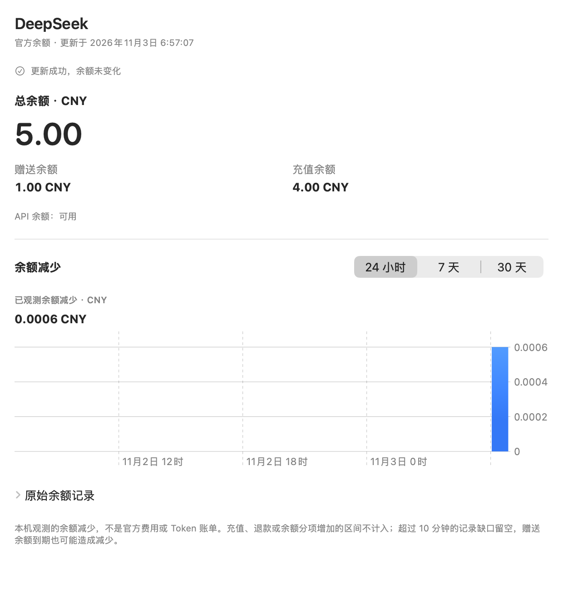
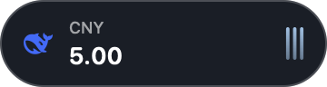
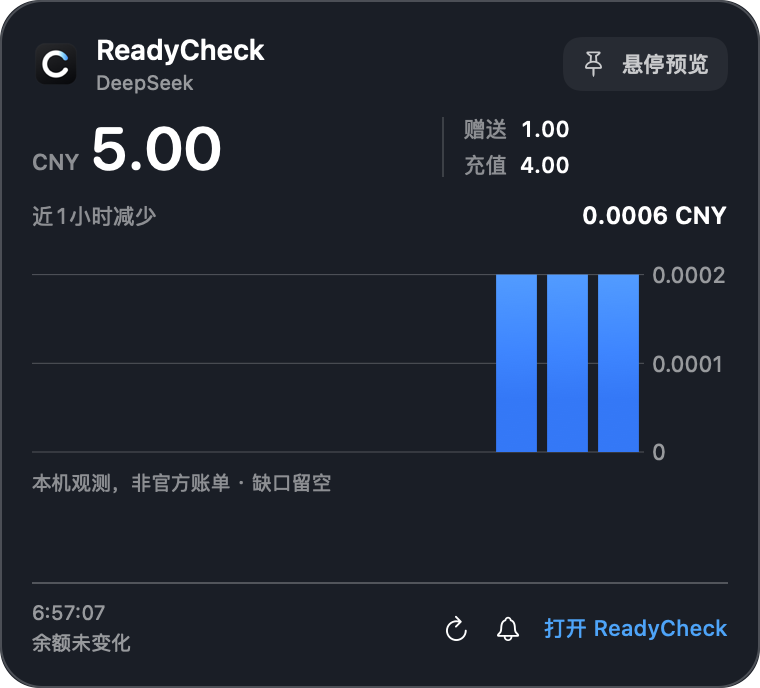

<p align="center"><a href="README.md">English</a> · 简体中文</p>

<h1 align="center">ReadyCheck</h1>
<p align="center"><strong>Codex 额度、DeepSeek 余额，一处掌握。</strong></p>
<p align="center">轻量、免费、开源的 macOS 监控工具，提供菜单栏、悬浮胶囊与刘海视图。</p>
<p align="center"><a href="https://github.com/whnnick/readycheck/tree/v0.7.0-dev.28"></a> <a href="docs/INSTALL.zh-CN.md"></a> <a href="LICENSE"></a></p>
<p align="center"><a href="#从这里开始">从这里开始</a> · <a href="docs/versions/0.7.0/RELEASE_NOTES.zh-CN.md#source-candidate-dev28">当前更新</a> · <a href="docs/versions/0.7.0/QA.zh-CN.md">验收与边界</a> · <a href="docs/VERSIONS.md">版本索引</a></p>

## 选择版本

| 通道 | 版本 | 获取方式 |
| --- | --- | --- |
| **最新源码 / 已打包候选** | **0.7.0-dev.28** | [源码 tag](https://github.com/whnnick/readycheck/tree/v0.7.0-dev.28) · [更新与安装包校验值](docs/versions/0.7.0/QA.zh-CN.md) |
| **最新可下载预览** | **0.7.0-dev.23** | [Mac DMG](https://github.com/whnnick/readycheck/releases/download/v0.7.0-dev.23/ReadyCheck-0.7.0-dev.23-macos.dmg) · [Windows ZIP](https://github.com/whnnick/readycheck/releases/download/v0.7.0-dev.23/ReadyCheck-0.7.0-dev.23-windows-x64-portable.zip) |
| 稳定发布通道 | 0.6.1 | [Mac DMG](https://github.com/whnnick/readycheck/releases/download/v0.6.1/ReadyCheck-0.6.1-macos.dmg) · [Windows ZIP](https://github.com/whnnick/readycheck/releases/download/v0.6.1/ReadyCheck-0.6.1-windows-x64-portable.zip) |

Dev.28 安装包及源码/tag 已验证，但 **dev.28 尚无公开 GitHub Release 或托管安装包资产**。上方预览下载继续指向 dev.23。下面的能力与截图介绍当前 dev.28 源码；[预览版差异](docs/versions/0.7.0/RELEASE_NOTES.zh-CN.md#public-preview-dev23)及[发布边界](docs/versions/0.7.0/QA.zh-CN.md)均有记录。

<p align="center"></p>
<p align="center"><sub>当前 dev.28 原生余额组件。所有截图均使用合成数据，不是真实账户。</sub></p>

## 能看到什么

| | Codex | DeepSeek API |
| --- | --- | --- |
| 连接 | ReadyCheck OAuth 登录 | API Key，独立保存 |
| 当前读数 | 实际返回的配额窗口、重置时间与可用状态 | 按币种显示官方余额、赠送与充值分项 |
| 历史 | 本机额度减少与接口返回的每日 Token 统计 | 本机观测的余额减少，缺口保持未知 |
| 账户信息 | 套餐、订阅、Credits 与重置卡记录，默认展开 | API 余额可用性和最近成功读取时间 |
| 提醒 | 低额度、实际恢复与重置卡到期节点 | 显式开启的余额阈值，按连接/币种隔离 |

**目前支持两条连接。** 十家服务目录还列出未来目标，其余八家尚未接入，不代表已经可读取。见[实施范围](docs/versions/0.7.0/TECHNICAL.zh-CN.md)。

## 工作时轻巧，需要时展开

<table>
<tr><th>胶囊与贴边条</th><th>余额详情</th></tr>
<tr><td align="center"><br></td><td align="center"></td></tr>
</table>

- **统一交互。** 悬停或普通点击胶囊只预览；只有显式固定按钮才保持展开，内容点击保留当前选择。固定展开与窗口置顶独立。
- **选择顺手的入口。** 菜单栏、胶囊/贴边、信息卡片或点击展开的刘海；保留记忆位置及原有显示控件。
- **账户信息更容易找到。** 权益默认展开；卡片记录结果与通知投递分开查看。
- **减少重复警告。** 已提醒的同一卡片异常在凭据恢复或重启后不重复提交，真正的新事件仍可提醒。
- **可选的临期用卡。** 合格卡片的最后一小时尝试需要按账号单独授权，与只读刷新和到期提醒独立。[用卡规则](docs/versions/0.3.0/RESET_CARD_AUTOMATION.zh-CN.md)。

## 单位和来源说清楚

- **额度：**剩余百分比与本机减少的百分点。80% 降到 70% 是减少 10 个百分点，不是 Token 数量。
- **Token：**Codex 返回的数量，按 UTC 自然日统计；与额度百分比没有固定换算关系。
- **余额：**带币种的金额。本机减少只是观察，不是官方费用或 Token 账单；充值、退款和赠送到期均可能影响余额。不用百分比进度条暗示余额上限。

未采样区间留空；过期/失败读数保留状态和原时间，不当作新鲜零值。历史按账号或连接隔离，无法确认归属的旧历史单独保留。

## 从这里开始

1. 下载上方 **Mac 预览版 DMG**，打开后将 ReadyCheck.app 复制到“应用程序”。
2. 在**设置 → 连接**中登录 Codex，或选择 DeepSeek 并在应用内输入 Key；需要时完成正常 macOS 钥匙串提示。
3. 在**设置 → 显示**中选择入口，在**设置 → 提醒**中独立配置提醒。

[Mac 安装与升级](docs/INSTALL.zh-CN.md) · [Windows 指南](docs/WINDOWS.zh-CN.md)

## 平台与验证

| 平台 | 当前范围 |
| --- | --- |
| **macOS / Apple 芯片 / 14+** | Codex + DeepSeek 原生客户端。Dev.28 有 **517 项检查通过**、安装版核心流程验收及[65项功能保留矩阵](docs/versions/0.7.0/RELEASE_AUDIT.zh-CN.md)。Mac 包沿用稳定自签名预览身份，未使用 Developer ID 签名或公证。 |
| **Windows x64** | 独立 Electron Codex 客户端与便携 ZIP，保留原界面，不含 Mac 的 DeepSeek/刘海新能力。制包/check/smoke/UI-smoke 已通过；已报告的 OAuth 403 与 Windows 实机验收仍待完成。[Windows QA](docs/WINDOWS_QA.zh-CN.md)。 |

其他账号、全部显示/Spaces/全屏组合、系统登录及每种真实提醒边界尚未全面验收，实际证据和发布门槛见[黑盒检查](docs/versions/0.7.0/QA.zh-CN.md)。

## 隐私

普通刷新读取已授权服务数据，不发送模型生成请求。Mac 凭据存于 Keychain，Windows 使用 Electron safeStorage。DeepSeek 凭据与 Codex 独立，本机历史保留身份边界。不要在 Issue 或截图中分享 Key、OAuth 回调 URL 或原始账号响应。

ReadyCheck 不会自动停止或恢复 Codex 任务；可选用卡需单独授权。ReadyCheck 与 OpenAI、DeepSeek 无隶属关系，相关名称与标识归其所有者。

## 构建与参与

macOS 源码需要兼容 Swift 6 的工具链和 macOS 14+：

```bash
swift test
scripts/build_and_run.sh
```

分发安装包遵循[发布流程](docs/RELEASE.zh-CN.md)；Windows 使用 Node.js 22.12–24 和现有打包脚本。另见[贡献指南](CONTRIBUTING.md)与[安全政策](SECURITY.md)。

[当前计划](docs/versions/0.7.0/PLAN.zh-CN.md) · [技术范围](docs/versions/0.7.0/TECHNICAL.zh-CN.md) · [更新日志](CHANGELOG.zh-CN.md) · [版本归档](docs/VERSIONS.md) · [问题反馈](https://github.com/whnnick/readycheck/issues) · [MIT 许可](LICENSE)
