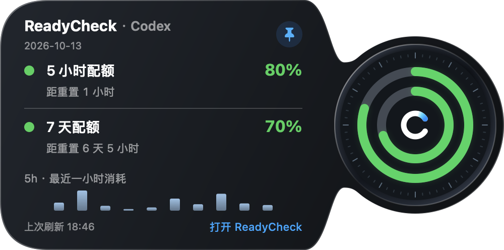

<p align="center">
  
</p>
<h1 align="center">ReadyCheck</h1>
<p align="center"><strong>写代码时，一眼知道 Codex 剩余额度。</strong></p>
<p align="center"><a href="README.md">English</a> · 简体中文</p>
<p align="center">
  <a href="https://github.com/whnnick/readycheck/releases/latest"></a>
  <a href="docs/INSTALL.zh-CN.md"></a>
  <a href="LICENSE"></a>
</p>
<p align="center">
  <a href="https://github.com/whnnick/readycheck/releases/latest"><strong>下载安装</strong></a> ·
  <a href="docs/INSTALL.zh-CN.md">从这里开始</a> ·
  <a href="https://www.youtube.com/shorts/bb5wakVj4Do">33 秒演示</a> ·
  <a href="docs/VERSIONS.md">版本与验收</a>
</p>

ReadyCheck 是一款免费的开源 Mac 额度监控工具，为使用 Codex 写代码的人把剩余额度和重置时间放在手边，减少切换页面。刷新只读取授权后的用量数据，不发送模型推理请求。

<p align="center">
  
</p>
<p align="center"><sub>0.1.145 原生 macOS 界面 · 合成演示数据 · 实际额度窗口以账号返回为准。</sub></p>

## 从这里开始

1. 从[最新 Release](https://github.com/whnnick/readycheck/releases/latest)下载 macOS DMG，将 ReadyCheck.app 拖入“应用程序”。
2. 启动 ReadyCheck，使用本机已登录的 Codex 账号，或选择单独 OAuth 登录。
3. 开启桌面 widget：悬停预览、点击保持详情，圆盘可在桌面与左右屏幕边缘之间直接拖动。

当前 macOS DMG 是 **Apple 芯片 arm64 包，要求 macOS 14+**，使用稳定预览签名，尚未采用 Developer ID 签名或公证；安装步骤见[安装说明](docs/INSTALL.zh-CN.md)。Windows 可从同一 Release 下载 x64 便携 ZIP，解压后运行 ReadyCheck.exe。

## 需要时展开，不用时贴边

<table>
  <tr>
    <th>桌面圆球</th>
    <th>贴边竖条</th>
  </tr>
  <tr>
    <td align="center"></td>
    <td align="center"></td>
  </tr>
  <tr>
    <td>剩余额度，一眼就能看见。</td>
    <td>贴边收起，向内一拖即可回到桌面。</td>
  </tr>
</table>

详情固定后，点击外部或切换焦点也会保持展开。取消固定恢复悬停预览；详情获得焦点后，Esc 可手动收起。固定控制详情是否常驻，与窗口置顶设置分开。

## 可以查看什么

- **额度与重置：**展示账号实际返回并验证过的额度窗口、剩余比例和重置倒计时；授权响应提供时显示 Credits。
- **用量历史：**本机 Codex app-server 返回且账号匹配时展示官方 Token 活动；否则明确显示本地额度下降，单位为百分点，不冒充 Token。
- **及时提醒：**保持运行时提供低额度和已验证恢复提醒，以及未使用重置券即将过期的提醒。
- **合适的显示方式：**主窗口、菜单栏、可拖动圆球/卡片/贴边样式，以及支持的 Mac 屏幕上的刘海配额条。内置简体中文和英文。

数据不可用或未通过验证时，会显示不可用，不估算剩余额度。恢复提醒依赖新鲜且验证过的读数；应用关闭期间未观测到的恢复不会事后重放。

| 平台 | 当前范围 |
| --- | --- |
| macOS | 原生界面、widget、刘海配额条及通知流程。已测条件和待补检查见[真实场景 QA](docs/QA.zh-CN.md)与[0.1.145 验收](docs/versions/0.1.145/QA.zh-CN.md)。 |
| Windows x64 | 独立便携预览；近期圆球、固定和边缘渲染调整仅支持 macOS。真实功能范围见[Windows 计划](docs/WINDOWS.zh-CN.md)与[Windows 验收](docs/WINDOWS_QA.zh-CN.md)。 |

## 隐私与账号访问

额度访问只读。可以跟随本机已登录 Codex 账号，或单独 OAuth 登录；macOS OAuth 凭据保存在系统 Keychain。刷新额度无需发送提示词或调用模型推理。发布日志和截图到 Issue 前，请移除账号信息和凭据。

ReadyCheck 是独立项目，与 OpenAI 无隶属或背书关系。Codex、ChatGPT 及其标志属于 OpenAI。

## 文档与开发

| 入口 | 内容 |
| --- | --- |
| [安装说明](docs/INSTALL.zh-CN.md) | 设置、平台条件及预览签名说明 |
| [版本索引](docs/VERSIONS.md) · [更新日志](CHANGELOG.zh-CN.md) | 产品需求、黑盒验收及发布历史 |
| [最新版验收](docs/versions/0.1.145/QA.zh-CN.md) | 原生边缘修复、测试证据和覆盖边界 |
| [真实场景 QA](docs/QA.zh-CN.md) | 实际安装与交互检查 |
| [贡献指南](CONTRIBUTING.md) · [发布流程](docs/RELEASE.zh-CN.md) | 开发与分发流程 |
| [安全政策](SECURITY.md) · [GitHub Issues](https://github.com/whnnick/readycheck/issues) | 安全报告、缺陷和反馈 |

源码构建需要 macOS 14+ 和支持 Swift 6 的工具链：

```bash
swift test
scripts/package_app.sh
```

本地 GUI 调试使用 `scripts/build_and_run.sh`；正式打包沿用[发布流程](docs/RELEASE.zh-CN.md)。当前脚本产物命名为 `ReadyCheck-0.1.145-macos.dmg` 和 `ReadyCheck-0.1.145-windows-x64-portable.zip`。

采用 [MIT](LICENSE) 许可。
