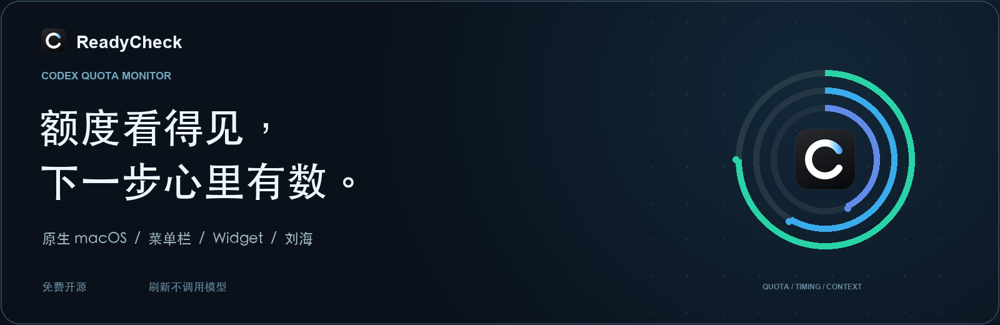
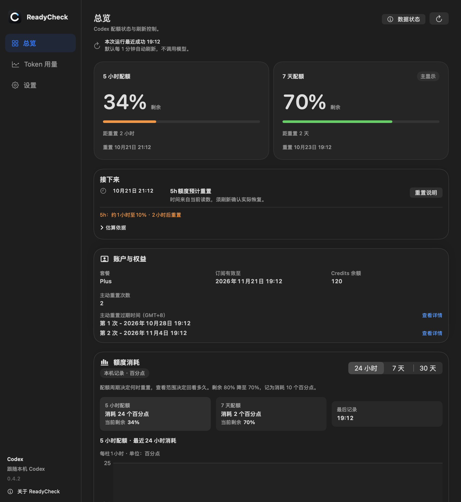
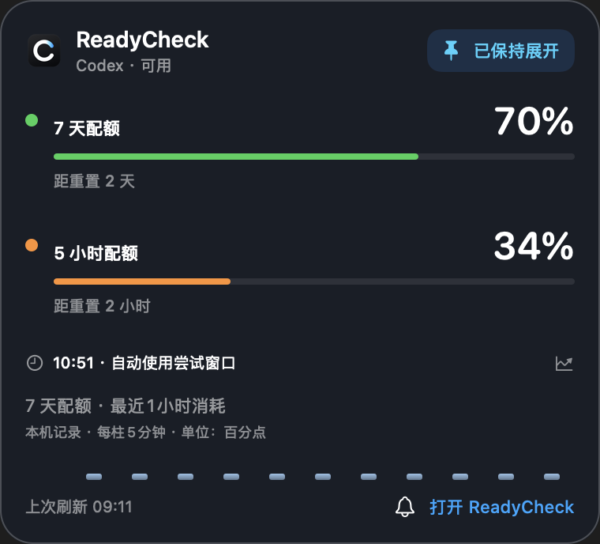

<p align="center"><a href="README.md">English</a> · 简体中文</p>

<h1 align="center">ReadyCheck</h1>
<p align="center"><strong>额度看得见，下一步心里有数。</strong></p>
<p align="center">为 Mac 打造的免费开源 Codex 额度监控工具。</p>
<p align="center"><a href="https://github.com/whnnick/readycheck/releases/tag/v0.4.2"></a> <a href="docs/INSTALL.zh-CN.md"></a> <a href="LICENSE"></a></p>
<p align="center"><a href="https://github.com/whnnick/readycheck/releases/download/v0.4.2/ReadyCheck-0.4.2-macos.dmg"><strong>↓ 下载 Mac 版</strong></a> &nbsp; · &nbsp; <a href="https://github.com/whnnick/readycheck/releases/download/v0.4.2/ReadyCheck-0.4.2-windows-x64-portable.zip">Windows 便携版</a></p>
<p align="center"><a href="docs/versions/0.4.2/RELEASE_NOTES.zh-CN.md">更新重点</a> · <a href="docs/INSTALL.zh-CN.md">安装指南</a> · <a href="docs/versions/0.4.2/QA.zh-CN.md">验收与边界</a> · <a href="docs/VERSIONS.md">全部版本</a></p>

<p align="center"></p>

## 从这里开始

1. 下载上方 **Mac DMG**，将 ReadyCheck.app 拖到“应用程序”。
2. 跟随本机已登录的 Codex 账号，或使用独立 OAuth 登录。如 macOS 请求钥匙串访问，请完成系统确认。
3. 在**设置 → 提醒**选择门槛，在**设置 → 显示**开启 Widget 或刘海。

**Mac：**Apple 芯片 / arm64、macOS 14+。沿用稳定**自签名预览**身份，**未经 Developer ID 签名或公证**，首次打开前请看[安装指南](docs/INSTALL.zh-CN.md)。**Windows：**解压 x64 便携包，运行 ReadyCheck.exe，保留原界面。

## 不只知道还剩多少

| 看清当前状态 | 看清接下来 | 让界面适应工作 |
| :--- | :--- | :--- |
| 同时查看 **5 小时与 7 天额度**、准确重置时间、账户权益和本机消耗。 | 总览、菜单与 Widget 共用同一条下一步：额度重置、条件用卡窗口或待处理事项。 | 原生主窗口、菜单栏、自适应 Widget 与点击展开的刘海，按自己的习惯选择。 |

<p align="center"></p>
<p align="center"><sub>真实原生界面，使用合成数据。这张 0.4.2 截图展示明确操作按钮与单层说明。</sub></p>

### 0.4.2：操作明确，说明一层看清

**不再猜箭头，也不用一层层点。** “接下来”用明确文字按钮打开重置说明、连接或详情。使用节奏只保留一个结论，点一次就能看到具体原因；菜单栏和 Widget 也直接打开完整说明。

<p align="center"></p>

[更新说明](docs/versions/0.4.2/RELEASE_NOTES.zh-CN.md) · [验证与边界](docs/versions/0.4.2/QA.zh-CN.md)。本次保留估算规则、提醒、自动用卡授权及历史。

## 工作时轻巧，需要时展开

<table>
<tr><th>最近一小时，随时看一眼</th><th>用卡结果，每一步看清楚</th></tr>
<tr><td align="center"></td><td align="center"></td></tr>
<tr><td>双额度、下一步和<strong>最近一小时图</strong>放在一起。需要时固定展开，专注时收在边缘。</td><td>查看原到期时间、账号授权、已记录结果及对应通知。通知送达与卡片兑换分别呈现。</td></tr>
</table>

<p align="center"><sub>原生 0.4.0 截图，使用合成数据；这些功能在 0.4.2 中继续保留。</sub></p>

- **一个自适应 Widget。** 气泡拖到左右边缘收成细竖条，向内拖回气泡；也可选择信息卡片，通过标题拖动。固定详情后，点击外部或切换焦点仍保持展开；取消固定恢复预览行为，Esc 可收起获得焦点的详情。
- **不易误触的刘海。** 点击展开，点击外部或按 Esc 收起；仅悬停不会弹出详情。
- **账户权益完整保留。** 套餐、订阅有效期、Credits、重置卡数量、逐卡到期时间、只读卡片记录和“关于”均可查看。
- **到期提醒减少重复。** 同一卡同一到期节点在系统接受通知后不再重复提交，后续72／48／24／12小时节点独立保留；明确提交失败可重试，提交与已验证送达分别记录。
- **各类提醒独立控制。** 低额度、恢复和重置卡到期分别控制。到期提醒默认开启；可选自动用卡默认关闭，需按账号单独授权。
- **可选的临期自动用卡。** 授权后，在条件满足时尝试使用进入最后一小时的合格卡片。确认成功后有独立通知和历史记录，不受到期提醒开关影响。[自动用卡规则](docs/versions/0.3.0/RESET_CARD_AUTOMATION.zh-CN.md)。

## 三处界面，两类数据

| 入口 | 显示内容 | 来源 |
| --- | --- | --- |
| Widget → 额度消耗 | 所选配额最近一小时，**每柱 5 分钟**，单位为百分点。 | 当前账号在本机成功刷新留下的记录。 |
| 总览 → 额度消耗 | 同一指标查看 **24 小时 / 7 天 / 30 天**，每柱一小时 / 六小时 / 一天。 | 与 Widget 相同的本机历史和下降计算规则。 |
| Token 用量 → 每日 Token 数量 | 接口返回的 Token 数量，按 **UTC 自然日**汇总。 | 官方返回且匹配当前账号的 Codex 统计，可能缺失。 |

**80% 降到 70%，记为消耗 10 个百分点。** 不是 10 个 Token，也不是原来 80% 的 10%。本机记录排除重置切换、无效或缺失读数、额度回升及超过十分钟的断档。跨周期累计可超过 100 个百分点，Widget 柱高按自身最大值缩放。额度与 Token **没有固定换算关系**；缺少 Token 数据不会用第二份额度图替代。使用节奏估算仅为条件参考，不承诺可工作时长。

## 能力与边界，明确写清

| 平台 | 发布范围 |
| --- | --- |
| **macOS** | 原生总览与菜单、共享下一步、卡片记录、自适应 Widget、一小时图、可拖卡片、点击刘海及账户历史。[0.4.1 验收](docs/versions/0.4.2/QA.zh-CN.md) · [65 项功能保留审计](docs/versions/0.4.0/RELEASE_AUDIT.zh-CN.md)。 |
| **Windows x64** | 独立便携预览，保留原界面。Mac 重构和本次 Mac 通知修复不宣称已移植到 Windows。[Windows 指南](docs/WINDOWS.zh-CN.md) · [验收](docs/WINDOWS_QA.zh-CN.md)。 |

ReadyCheck **不会自动停止或恢复 Codex 任务**。重置时间到达后，仍需新读数确认恢复；关闭期间未观测到的恢复不会补发。真实卡片兑换、另一真实账号、多显示器 / Spaces、专注 / 睡眠、VoiceOver 和 Windows 实机不宣称已全面验收，实际覆盖范围请以版本验收文档为准。

## 隐私与账户访问

刷新读取已授权用量数据，**不发送模型生成请求**。额度刷新只读；可选用卡是单独授权的变更操作。可跟随本机 Codex 账号或独立 OAuth 登录，Mac OAuth 凭据存于系统钥匙串。历史按账号隔离，无法归属的旧历史单独保全。分享日志或截图前请移除凭据和账号信息。

ReadyCheck 是独立项目，与 OpenAI 无隶属或背书关系。Codex、ChatGPT 及其标识归 OpenAI 所有。

## 文档与开发

[安装](docs/INSTALL.zh-CN.md) · [更新日志](CHANGELOG.zh-CN.md) · [版本索引](docs/VERSIONS.md) · [贡献指南](CONTRIBUTING.md) · [发布流程](docs/RELEASE.zh-CN.md) · [安全政策](SECURITY.md) · [问题反馈](https://github.com/whnnick/readycheck/issues)

源码构建需要 macOS 14+ 及兼容 Swift 6 的工具链：

```bash
swift test
scripts/package_app.sh
```

开发启动使用 `scripts/build_and_run.sh`，分发遵循发布流程。采用 [MIT](LICENSE) 许可。


<details>
<summary>产品计划、历史设计与功能保留记录</summary>

- **0.4.2：**[更新说明](docs/versions/0.4.2/RELEASE_NOTES.zh-CN.md) · [验收](docs/versions/0.4.2/QA.zh-CN.md) · [功能保留](docs/versions/0.4.2/RELEASE_AUDIT.zh-CN.md)。
- **0.4.1：**[计划](docs/versions/0.4.1/PLAN.zh-CN.md) · [验收](docs/versions/0.4.1/QA.zh-CN.md)。
- **0.4.0：**[计划](docs/versions/0.4.0/PLAN.zh-CN.md) · [原生契约](docs/versions/0.4.0/TECHNICAL.zh-CN.md) · [更新说明](docs/versions/0.4.0/RELEASE_NOTES.zh-CN.md) · [验收](docs/versions/0.4.0/QA.zh-CN.md) · [保留审计](docs/versions/0.4.0/RELEASE_AUDIT.zh-CN.md) · [设计原型档案](docs/versions/0.4.0/prototype/README.zh-CN.md)。
- **0.3.0：**[65 项旧功能保留基线](docs/versions/0.3.0/FEATURE_RETENTION.zh-CN.md) · [计划与边界](docs/versions/0.3.0/PLAN.zh-CN.md) · [原生契约](docs/versions/0.3.0/TECHNICAL.zh-CN.md) · [额度节奏原型](docs/versions/0.3.0/prototype/README.zh-CN.md)。原型未展示不代表获准删减功能。
- **0.2.2：**[连接可靠性](docs/versions/0.2.2/PLAN.zh-CN.md) · [验收](docs/versions/0.2.2/QA.zh-CN.md)，已包含于 0.3.0。
- **0.2.1：**[计划](docs/versions/0.2.1/PLAN.zh-CN.md) · [验收](docs/versions/0.2.1/QA.zh-CN.md)。
- **0.2.0：**[计划](docs/versions/0.2.0/PLAN.zh-CN.md) · [完整检查](docs/versions/0.2.0/UPGRADE_REVIEW.zh-CN.md) · [黑盒验收](docs/versions/0.2.0/QA.zh-CN.md)。

</details>
