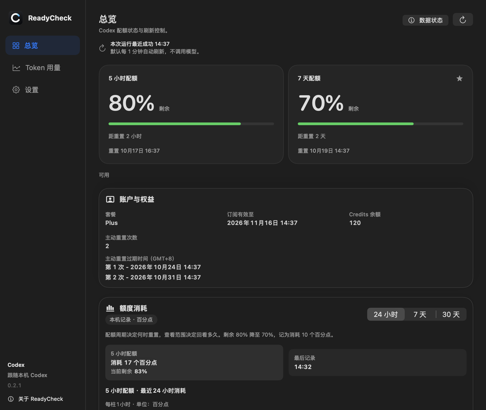
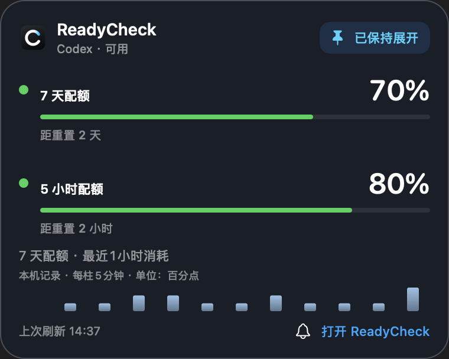

[English](README.md) · 简体中文

<p align="center"></p>
<h1 align="center">ReadyCheck</h1>
<p align="center"><strong>工作时，一眼掌握 Codex 剩余额度。</strong></p>
<p align="center"><a href="https://github.com/whnnick/readycheck/releases/latest"></a> <a href="docs/INSTALL.zh-CN.md"></a> <a href="LICENSE"></a></p>
<p align="center"><a href="https://github.com/whnnick/readycheck/releases/latest"><strong>下载</strong></a> · <a href="docs/versions/0.2.1/RELEASE_NOTES.zh-CN.md">更新重点</a> · <a href="docs/INSTALL.zh-CN.md">安装</a> · <a href="docs/VERSIONS.md">版本与验收</a></p>

ReadyCheck 是免费开源的 Codex 额度监控工具。在原生 Mac 窗口、菜单栏或可选桌面 Widget 中查看剩余额度、重置时间和账户权益。刷新只读取已授权的用量数据，不发送模型生成请求。

## 0.2.1 更新重点

- **圆球与竖条合并**：靠边收成细竖条，向内拖回圆球，共用详情、最近一小时图和固定状态，保留旧贴边位置。
- **信息卡片自由移动**：拖动标题即可移动，按钮操作独立，位置继续记忆。
- **详情固定更一致**：点击预览内容或空白区都可保持展开，主动取消固定后恢复原有收起规则。
- **边缘和动效修复**：贴边展开不再闪出圆圈，轮廓内描边避免裁切。
- **更新要点归入关于**：连接设置不再重复展示；配额窗口、提醒、账户权益和历史继续保留。

<p align="center"></p>
<p align="center"><sub>最新版原生 macOS 界面 · 合成演示数据，不含私人账户截图。</sub></p>

[完整更新说明](docs/versions/0.2.1/RELEASE_NOTES.zh-CN.md) · [黑盒检查与覆盖边界](docs/versions/0.2.1/QA.zh-CN.md)

## 从这里开始

1. 在[最新发布](https://github.com/whnnick/readycheck/releases/latest)下载 **ReadyCheck-0.2.1-macos.dmg**，将 ReadyCheck.app 拖到“应用程序”。
2. 启动后跟随本机 Codex 登录账号，或使用独立 OAuth 登录；如 macOS 请求钥匙串访问，请完成系统确认。
3. 在“设置 → 提醒”选择门槛，在“设置 → 显示”开启 Widget 或刘海。

Mac 下载为 **arm64 / Apple 芯片、macOS 14+**，沿用稳定的**自签名预览**身份，**未经 Developer ID 签名或公证**，见[安装说明](docs/INSTALL.zh-CN.md)。Windows 可在同一发布页下载 **ReadyCheck-0.2.1-windows-x64-portable.zip**，解压运行 ReadyCheck.exe。

## 三处界面，两类数据

| 入口 | 柱子的含义 | 来源 |
| --- | --- | --- |
| Widget → 额度消耗 | 所选配额最近一小时，每柱五分钟，单位为**百分点**。 | 当前账号在本机成功刷新留下的记录。 |
| 总览 → 额度消耗 | 同一指标查看最近 24 小时／7 天／30 天，每柱一小时／六小时／一天。 | 与 Widget 相同的本机历史和下降计算规则。 |
| Token 用量 → 每日 Token 数量 | 接口返回的 Token 数量，按 UTC 自然日汇总。 | 官方返回且匹配当前账号的 Codex 统计，可能缺失。 |

剩余 80% 降到 70%，记为消耗 **10 个百分点**，不是 10 个 Token，也不是原来 80% 的 10%。本机记录排除重置切换、无效或缺失读数、额度回升及超过十分钟的断档。跨多个周期的累计消耗可以超过 100 个百分点。Widget 柱高按自身最大值缩放。额度与 Token **没有固定换算关系**，缺少 Token 数据不会用第二份额度图替代。

## 桌面交互与平台范围

<p align="center"> &nbsp; </p>

<p align="center"></p>

在“设置 → 显示”选择悬浮气泡或信息卡片；悬浮气泡拖到边缘收成细竖条，向内拖回圆球，信息卡片通过标题拖动。Widget 固定详情后，点击其他区域或切换焦点仍保持展开；取消固定恢复预览行为，Esc 可收起获得焦点的详情。支持桌面与左右贴边之间直接拖动。刘海点击展开，点击外部或 Esc 收起。

| 平台 | 0.2.1 范围 |
| --- | --- |
| macOS | 自适应悬浮 Widget、卡片拖动和交互／轮廓修复，保留原生侧栏／菜单栏、刘海及账户历史；真实设备已验项目与剩余覆盖见[验收文档](docs/versions/0.2.1/QA.zh-CN.md)。 |
| Windows x64 | 独立便携预览，保留原界面；本次没有把 Mac 重构移植到 Windows，见 [Windows 说明](docs/WINDOWS.zh-CN.md)和[验收](docs/WINDOWS_QA.zh-CN.md)。 |

ReadyCheck 提供提醒，**不会自动停止或恢复 Codex 任务**，也不自动使用重置券。恢复提醒只依据新鲜且可验证的读数，关闭期间未观测到的恢复不会补发。多显示器／Spaces、专注／睡眠、VoiceOver 及正式分发签名仍未宣称全面验收。

## 隐私与账户访问

额度访问只读。可跟随本机 Codex 账号或独立 OAuth 登录，Mac 凭据存于系统钥匙串。新历史按账号隔离，无法归属的旧历史单独保全。反馈日志或截图前请移除账号和凭据。

ReadyCheck 是独立项目，与 OpenAI 无隶属或背书关系；Codex、ChatGPT 及其标识归 OpenAI 所有。

## 文档与开发

[0.2.1 计划](docs/versions/0.2.1/PLAN.zh-CN.md) · [功能检查](docs/versions/0.2.1/QA.zh-CN.md)。0.2.0 基础版本的完整检查归档见下方。

- [安装](docs/INSTALL.zh-CN.md) · [更新日志](CHANGELOG.zh-CN.md) · [版本索引](docs/VERSIONS.md)
- [0.2.0 计划](docs/versions/0.2.0/PLAN.zh-CN.md) · [完整检查](docs/versions/0.2.0/UPGRADE_REVIEW.zh-CN.md) · [黑盒检查](docs/versions/0.2.0/QA.zh-CN.md)
- [贡献指南](CONTRIBUTING.md) · [发布流程](docs/RELEASE.zh-CN.md) · [安全政策](SECURITY.md) · [问题反馈](https://github.com/whnnick/readycheck/issues)

源码构建需要 macOS 14+ 及兼容 Swift 6 的工具链：

```bash
swift test
scripts/package_app.sh
```

开发启动使用 `scripts/build_and_run.sh`，分发遵循发布流程。采用 [MIT](LICENSE) 许可。
