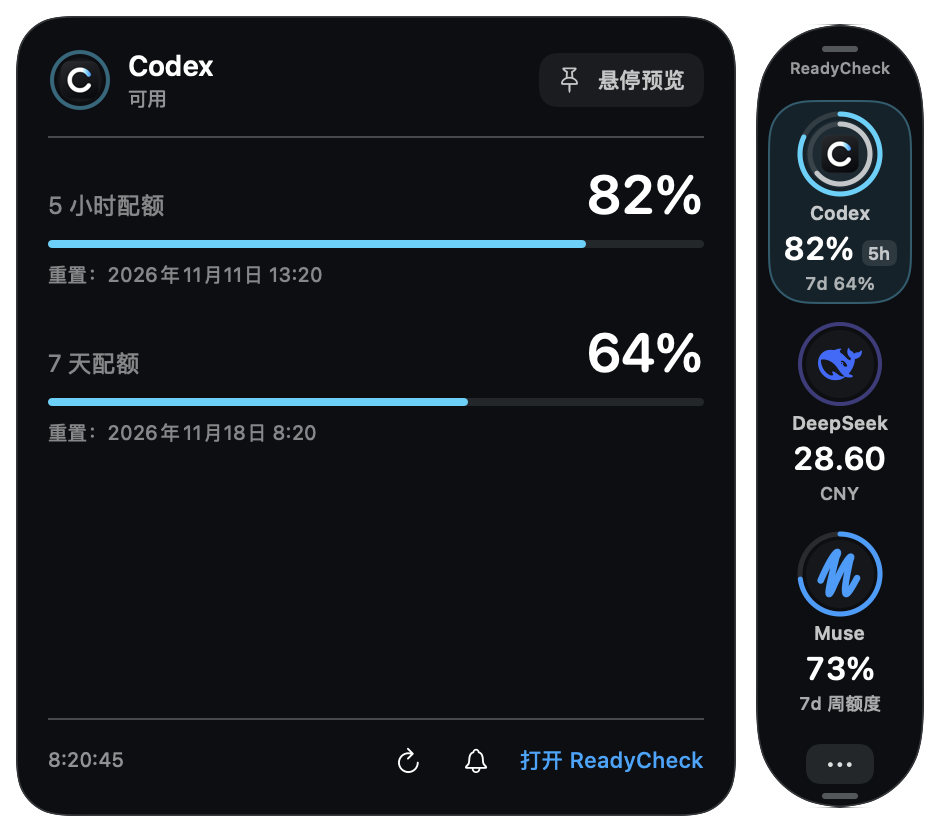
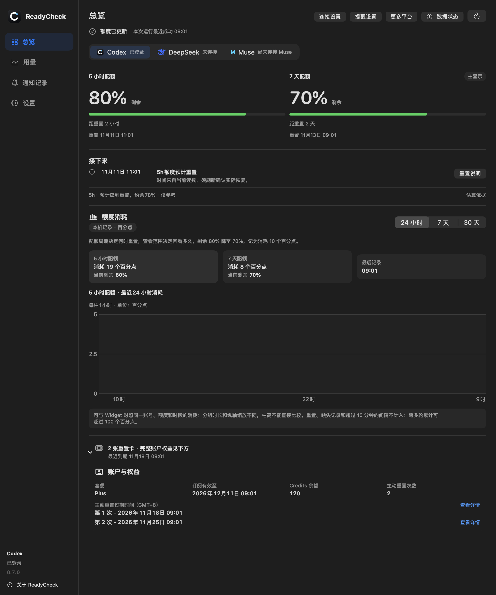
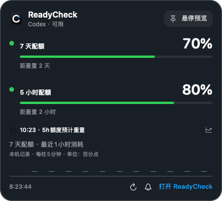
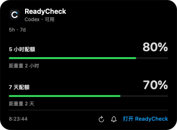
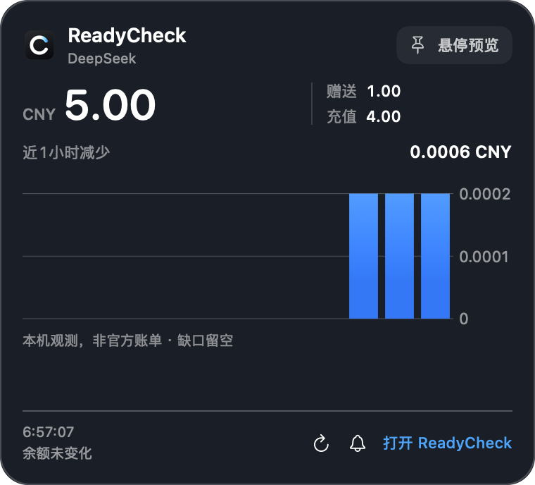

<p align="center"><a href="README.md">English</a> · 简体中文</p>

<h1 align="center">ReadyCheck</h1>
<p align="center"><strong>Codex 还剩多少额度，什么时候重置，一眼看清。</strong></p>
<p align="center">以 Codex 为核心的轻量、免费、开源监控工具：额度、Token 用量、账户权益与提醒。</p>
<p align="center"><a href="https://github.com/whnnick/readycheck/tree/v0.7.4"></a> <a href="docs/INSTALL.zh-CN.md"></a> <a href="LICENSE"></a></p>
<p align="center"><a href="#从这里开始">从这里开始</a> · <a href="docs/versions/0.7.4/RELEASE_NOTES.zh-CN.md">当前更新</a> · <a href="docs/versions/0.7.4/QA.zh-CN.md">验收与边界</a> · <a href="docs/VERSIONS.md">版本索引</a></p>

**ReadyCheck 0.7.4** 为 macOS 左侧导航、设置和常驻聚合胶囊加入玻璃选中动效。鼠标点选时玻璃底带细高光滑动，键盘导航时显示系统焦点色。 [发布说明](docs/versions/0.7.4/RELEASE_NOTES.zh-CN.md) · [验收](docs/versions/0.7.4/QA.zh-CN.md)。



## 选择版本

| 通道 | 版本 | 获取方式 |
| --- | --- | --- |
| 稳定发布通道 | 0.7.4 | [Mac DMG](https://github.com/whnnick/readycheck/releases/download/v0.7.4/ReadyCheck-0.7.4-macos.dmg) · [Windows ZIP](https://github.com/whnnick/readycheck/releases/download/v0.7.4/ReadyCheck-0.7.4-windows-x64-portable.zip) |
| **公开源码** | **0.7.4** | [源码 tag](https://github.com/whnnick/readycheck/tree/v0.7.4) · [发布说明](docs/versions/0.7.4/RELEASE_NOTES.zh-CN.md) |
| **上一预览版** | **0.7.2-dev.12** | [Mac DMG](https://github.com/whnnick/readycheck/releases/download/v0.7.2-dev.12/ReadyCheck-0.7.2-dev.12-macos.dmg) · [Windows ZIP](https://github.com/whnnick/readycheck/releases/download/v0.7.2-dev.12/ReadyCheck-0.7.2-dev.12-windows-x64-portable.zip) |

稳定版下载为 0.7.4，安装包检查、Windows 运行器结果和设备边界见[验收记录](docs/versions/0.7.4/QA.zh-CN.md)。

<p align="center"></p>
<p align="center"><sub>0.7.0 Codex 界面。所有截图均使用合成数据，不是真实账户。</sub></p>

## 围绕 Codex 的日常使用

| 关心的问题 | ReadyCheck 提供什么 |
| --- | --- |
| 还能用多少？ | 同时查看 5 小时、7 天等实际返回的额度窗口、剩余比例与可用状态。 |
| 什么时候恢复？ | 重置时间与倒计时、下一事件，以及根据当前周期本机采样显示的使用节奏；样本不足时明确说明。 |
| 最近用了多少？ | 总览查看本机额度减少，用量页查看接口返回的每日 Token 统计；支持历史范围与柱条悬停提示。 |
| 账户有哪些权益？ | 套餐、订阅有效期、Credits、重置卡数量与到期记录；账户与权益默认展开，仍可手动折叠。 |
| 什么时候需要留意？ | 低额度、实际恢复和卡片到期提醒，以及通知历史；凭据恢复后撤回旧警告，同一卡片异常避免重复提醒。 |
| 是否自动用卡？ | 独立、按账号授权的临期卡片尝试，与只读刷新、到期提醒分开。[用卡规则](docs/versions/0.3.0/RESET_CARD_AUTOMATION.zh-CN.md)。 |

账户字段以实际返回的数据为准，缺失值不补造。ReadyCheck 不会自动停止或恢复 Codex 任务。

## Codex 随手看，不必一直开主窗口

<table>
<tr><th>Codex 悬浮胶囊</th><th>Codex 刘海详情</th></tr>
<tr><td align="center"></td><td align="center"></td></tr>
</table>

- **选择顺手的入口。** 菜单栏、悬浮胶囊/贴边、信息卡片或点击展开的刘海，保留记忆位置及显示控件。
- **需要时展开。** 悬停或普通点击胶囊只预览；显式固定按钮保持展开，点击内容保留选择。固定展开与窗口置顶独立。
- **从摘要回到详情。** 在小窗中刷新、查看提醒或打开 ReadyCheck 主窗口，继续检查额度、历史与账户权益。

## 补充支持：DeepSeek API 余额

macOS 还支持独立的 DeepSeek API Key 连接：按币种显示官方余额、赠送/充值分项、最近成功读取时间，以及本机观测的余额减少。提供余额胶囊、贴边与刘海布局；余额阈值提醒需要显式开启，并按连接与币种隔离。

<p align="center"></p>

## 补充支持：Meta Muse 应用周额度

在**设置 → 连接 → Muse** 中打开独立登录窗口，登录后点击“完成并读取额度”。提供周剩余额度、重置、套餐及服务端提供的额外额度/续期标签，每 5 分钟自动刷新，支持总览、菜单栏、胶囊、贴边、卡片与刘海。此连接面向 muse.ai 个人助手，当前不含逐日 Token 历史或 Muse 专属提醒。

Codex 与 DeepSeek 已有真实连接验收；Muse 已通过本机真实登录、订阅读取、手动刷新与用量页检查，其他账号尚未验收。服务目录现有 11 项，其中其余八项仍待接入，见[实施范围](docs/versions/0.7.0/TECHNICAL.zh-CN.md)。

## 单位和来源说清楚

- **额度：**剩余百分比与本机减少的百分点。80% 降到 70% 是减少 10 个百分点，不是 Token 数量。
- **Token：**Codex 返回的数量，按 UTC 自然日统计；与额度百分比没有固定换算关系。
- **余额：**带币种的金额。本机减少只是观察，不是官方费用或 Token 账单；充值、退款和赠送到期均可能影响余额。不用百分比进度条暗示余额上限。

未采样区间留空；过期/失败读数保留状态和原时间，不当作新鲜零值。历史按账号或连接隔离，无法确认归属的旧历史单独保留。

## 从这里开始

1. 下载上方 **Mac DMG**，打开后将 ReadyCheck.app 复制到“应用程序”。
2. 在**设置 → 连接**中登录 Codex，需要时完成正常 macOS 钥匙串提示。DeepSeek 用户可另行添加 API Key 连接。
3. 在**设置 → 显示**中选择入口，在**设置 → 提醒**中独立配置提醒。

[Mac 安装与升级](docs/INSTALL.zh-CN.md) · [Windows 指南](docs/WINDOWS.zh-CN.md)

## 平台与验证

| 平台 | 当前范围 |
| --- | --- |
| **macOS / Apple silicon / 14+** | Codex、DeepSeek、Muse 及聚合胶囊。**543 项 Swift 回归及 11 项读取器 JavaScript 测试通过**，另有原生窗口和安装版实测。[QA](docs/versions/0.7.0/QA.zh-CN.md)。 |
| **Windows x64** | 独立 Electron Codex 客户端与便携 ZIP，Windows 运行器上的服务、UI 冒烟及原生网络栈检查通过。原报 OAuth 403 电脑的真实账号结果仍有待验证。[Windows QA](docs/WINDOWS_QA.zh-CN.md)。 |

其他账号、全部显示/Spaces/全屏组合、系统登录及每种真实提醒边界尚未全面验收，实际证据和发布门槛见[黑盒检查](docs/versions/0.7.0/QA.zh-CN.md)。

## 隐私

普通刷新读取已授权服务数据，不发送模型生成请求。Mac API/OAuth 凭据存于 Keychain，Muse 网页登录保存在独立 WebKit 会话中；Windows 使用 Electron safeStorage。DeepSeek 凭据与 Codex 独立，本机历史保留身份边界。不要在 Issue 或截图中分享 Key、OAuth 回调 URL 或原始账号响应。

ReadyCheck 不会自动停止或恢复 Codex 任务；可选用卡需单独授权。ReadyCheck 与 OpenAI、DeepSeek、Meta 无隶属关系，相关名称与标识归其所有者。

## 构建与参与

macOS 源码需要兼容 Swift 6 的工具链和 macOS 14+：

```bash
swift test
scripts/build_and_run.sh
```

分发安装包遵循[发布流程](docs/RELEASE.zh-CN.md)；Windows 使用 Node.js 22.12–24 和现有打包脚本。另见[贡献指南](CONTRIBUTING.md)与[安全政策](SECURITY.md)。

[当前计划](docs/versions/0.7.0/PLAN.zh-CN.md) · [技术范围](docs/versions/0.7.0/TECHNICAL.zh-CN.md) · [更新日志](CHANGELOG.zh-CN.md) · [版本归档](docs/VERSIONS.md) · [问题反馈](https://github.com/whnnick/readycheck/issues) · [MIT 许可](LICENSE)
