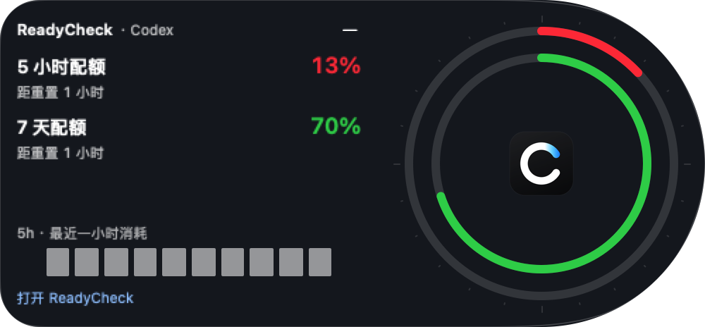

# 0.1.136 acceptance

[中文](QA.zh-CN.md) · [Requirements](PLAN.md) · [Versions](../../VERSIONS.md)

Status: superseded by [0.1.137](../0.1.137/QA.md) after the user rejected the flattened appearance. The record below describes the earlier preview; unlocked-device acceptance and the handshake recheck are recorded in 0.1.137.

The image uses synthetic 13% / 70% observations to inspect the actual SwiftUI component; it is not a live account reading.

| Requirement | Result / evidence |
| --- | --- |
| Continuous exterior | Passed observed Chinese and English installed empty-data interfaces plus anonymous native component captures: one outline/background, attached concentric dial, no separate dial bezel or neck seam. This is an implementation capture, not Image Gen artwork. |
| Quota correspondence | Passed existing extra-window, weekly-only, empty and restored-selection checks. Anonymous 13% / 70% component capture uses the packaged C icon. Outer ring follows the primary selection; inner ring is the next displayed window; all windows remain in scrollable details. |
| Geometry | Passed native window/content-size test through edge→expanded→edge. Computer Use initially exposed a retained edge-tab height after dragging; explicit hosting sizing and autoresizing fixed it, and the next installed capture shows a circular 92-point resting bubble. Free left/right expansion anchor and narrow-display limits have deterministic coverage. |
| Interaction | Existing hover/drag/pin/cancel/Space tests retained. Installed click opens the continuous surface and its Open ReadyCheck link returns to the main window. Continuous pointer feel and final installed Esc / mirrored-left rendering await unlocked-device acceptance. |
| Recent hour | Passed tests for known zero versus unknown, observed decreases, invalid/future/out-of-range values, reset changes, recovery, missing-window boundaries and long gaps. Uses existing local samples; no new network requests or Token conversion. |
| Build / identity | Local app builds with the existing stable preview identity and passes strict signature verification. Installed executable hash matches the final local package. The still-running earlier process must restart after unlock to pick up the last label/empty-state polish. Version metadata, bilingual changelogs/README and version index are synchronized. Windows metadata only. |
| Account / device | Existing saved credentials were preserved. The system authorization process waits; the tool cannot operate SecurityAgent, and Computer Use subsequently reported the Mac locked. No Keychain data, permissions or notification caches were cleared. Real quota rendering after verification remains pending. |

Completed: selected bubble design, real-data wiring, anonymous native UI checks and focused geometry/aggregation tests. Partial: runtime styling was inspected with unavailable data; live current quota, physical pointer feel, final language restoration and final app restart remain pending unlock/verification. Other widget entries and the full-screen policy are retained; this iteration does not claim additional physical notch/multiple-display acceptance or redesign the main window.

Verification: an earlier full run passed all 263 tests. The last full evidence run passed 262 of 263; `testMonitorRejectsInitializationErrorWithoutEmittingUpdate` exceeded its existing one-second wait, and its isolated retry also timed out. The monitor implementation was not changed. Final scoped verification runs 28 relevant tests: 27 pass, with the native pinned-window sizing test explicitly skipped when the test app cannot retain foreground/key focus; it passed before the session locked. A locked-session sizing run lost focus and collapsed the panel, so that result is not claimed as a geometry failure or pass.

Release blockers: complete the pending unlocked-device checks and resolve/recheck the handshake timeout before public publication. Delivery in this iteration is local; no public push or Release. No unrelated timeout threshold was relaxed to obtain a pass.

Commands: `swift test --build-system native --scratch-path <temporary-directory>`, optional `READYCHECK_UI_EVIDENCE_DIR` and `READYCHECK_UI_APP_ICON` for anonymous native captures, `scripts/check_release_consistency.sh`, `git diff --check`, `bash -n` on packaging scripts, `scripts/package_app.sh` and `codesign --verify --deep --strict`.
