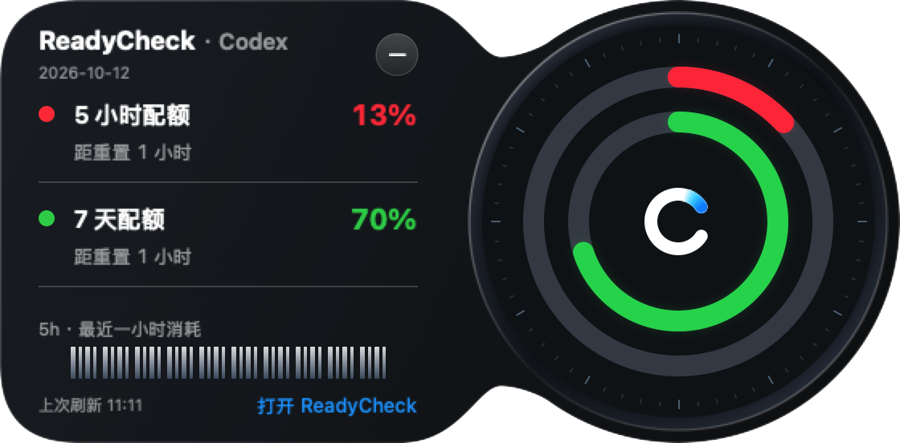

# 0.1.137 黑盒验收

[English](QA.md) · [需求](PLAN.zh-CN.md) · [版本索引](../../VERSIONS.md)

状态：2026年10月12日完成本地0.1.137安装及界面检查；未公开推送或发布Release。

实际SwiftUI组件使用合成13% / 70%数据渲染，不是实时账号或生成设计稿。[竖条截图](assets/bubble-edge-rail-demo.png)使用同样的匿名值及应用C图标。

| 需求 | 结果与证据 |
| --- | --- |
| 原稿外观 | 已检查收腰外壳、柔和连接、金属边框、刻度、粗同心弧、独立C、额度色点、分隔线及蓝色入口。原生遮罩和可见外壳共用路径；数字日期与原稿一致。 |
| 额度与历史 | 额外窗口、仅周额度、空数据和恢复选择截图检查通过；全部窗口可滚动查看。安装版最终实际OAuth观测为46% / 86%，橙/绿色圆弧与详情百分比相符。未知/过期保持未知。小图聚合测试通过，四根细线呈现同一个五分钟观测值，不是四次新观测。 |
| 贴边与拖动 | 电脑工具已拖到左右两侧，观察双额度竖条和向内展开，再拖离边缘恢复圆球。左右布局已检查；最终恢复中文并放在右侧自由位置。 |
| 交互 | 安装版点击固定、Esc收起、自动悬停预览及移开后收起已观察；保留悬停/拖动取消测试。工具不能完整量化逐帧动效与主观鼠标手感。 |
| 几何 | 窗口/内容尺寸测试通过。新增遮罩测试覆盖圆球及竖条21个过渡步骤、两种方向，检查边界与中央完整。系统圆弧三次曲线近似需要0.1点亚像素容差；最初0.01点断言过严。 |
| 构建与账号 | 最终包已安装，沙箱外严格签名检查通过，可执行文件摘要与构建产物一致。保留应用身份、凭据及通知设置；用户完成多次系统钥匙串验证后，最终进程已读到真实额度。Windows仅同步版本。 |

已完成：原稿样式、两侧竖条、真实数据、本机安装及原生截图。部分完成：物理动效手感仍由用户判断。未实施：主窗口重画或额外功能。本轮没有重新验收物理刘海、多显示器和全屏行为。

最终全量测试264项通过，无跳过/失败，包括此前偶发超时的初始化错误握手测试。打包、版本一致性、文档链接、`git diff --check`和修改文本敏感检查通过。验证使用`swift test --build-system native --scratch-path <临时目录>`、`scripts/package_app.sh`、`scripts/check_release_consistency.sh`、`codesign --verify --deep --strict`；匿名截图使用`READYCHECK_UI_EVIDENCE_DIR` / `READYCHECK_UI_APP_ICON`。

当前本地预览没有阻塞。公开发布仍需标准双平台流程及远端验证，本轮未要求。
