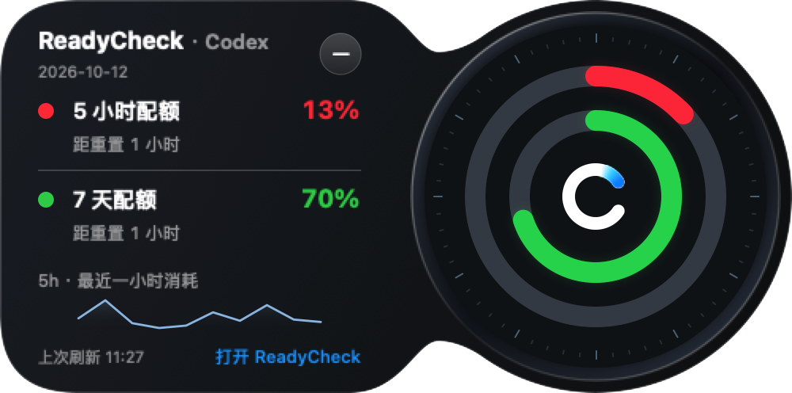

# 0.1.138 acceptance

[中文](QA.zh-CN.md) · [Requirements](PLAN.md) · [Versions](../../VERSIONS.md)

Status: local 0.1.138 installed and inspected on October 12, 2026; no public push or Release.

The actual SwiftUI component uses synthetic quota/history values, not live account data or generated artwork. [English capture](assets/bubble-compact-en-demo.png).

| Requirement | Result / evidence |
| --- | --- |
| Compact size | 500 × 248 points versus 560 × 276, 19.8% less area. Chinese/English native captures inspected; window/content-size and both-orientation mask tests pass. Detail spacing tightened and scroll indicators hidden after installed acceptance exposed a scrollbar covering percentages. All windows remain scrollable. |
| Line / fill | Installed real-data curve inspected. No four-stroke repetition. Tests check sample positions, exact peak/intermediate values, known zero versus unknown/invalid values and isolated points. Missing bins split segments, so neither line nor fill bridges gaps. Linear interpolation preserves extrema. |
| Data meaning | Existing five-minute quota-decrease aggregation retained; tooltip states percentage points, distinct from remaining quota and Token usage. No new polling or fabricated fluctuations. |
| Existing interactions | Installed right rail opens inward; Esc restores the rail; dragging away restores a circle and clicking opens compact details. Final Chinese free-bubble reading observed at 32% / 84%, with matching orange / green rings. These are dated readings. Left layout has native component and existing placement coverage, not an additional physical left-edge trial in this iteration. |
| Build / account | Final app signed with the existing identity; strict signature verification passes outside the sandbox. Installed executable digest matches the package. User completed system Keychain verification; final running app reads actual quotas. Credentials/notification settings preserved. Windows metadata only. |

Completed: size reduction, thin line/fill, data-gap handling, bilingual native captures and local installation. Partial: subjective motion feel remains a user judgment. Not implemented: additional features or a main-window chart redesign. No renewed physical notch/multiple-display acceptance.

Verification: full suite 267 tests passed with no skips/failures; after the final spacing/scroll-indicator adjustment, all 7 relevant native UI/chart tests passed. Packaging, version consistency, modified-document links, `git diff --check` and changed-text sensitive-data checks passed. Commands: `swift test --build-system native --scratch-path <temporary-directory>`, `scripts/package_app.sh`, `scripts/check_release_consistency.sh`, `codesign --verify --deep --strict`. Captures use `READYCHECK_UI_EVIDENCE_DIR` / `READYCHECK_UI_APP_ICON`.

No blocker remains for this local preview. Public distribution requires the standard two-platform release workflow, which was not requested here.
