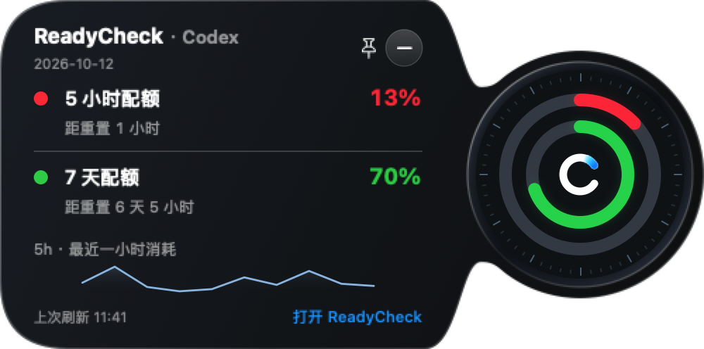

# 0.1.139 黑盒验收

[English](QA.md) · [需求](PLAN.zh-CN.md) · [版本索引](../../VERSIONS.md)

状态：2026年10月12日完成本地0.1.139安装和检查；没有公开推送或发布Release。

实际SwiftUI预览态，含固定按钮及合成13% / 70%数据，不是实时账号或生成设计稿。[英文预览](assets/bubble-preview-en-demo.png)。测试包含多天倒计时，不依赖短标签验收。

| 需求 | 结果与证据 |
| --- | --- |
| 小表盘 | 表盘区域176点，详情区域324点；实际表盘160点，相比0.1.138的232点约小31%。已检查圆环/C同比缩放；自由中心固定、小显示器限制、两种方向和完整过渡边界测试通过。 |
| 预览标题/倒计时 | 中英文原生预览含固定按钮时，ReadyCheck单行，多天重置文案完整。安装版真实数据固定详情也已检查；最终观测23% / 82%，红/绿圆弧相符，倒计时可读。额外窗口仍可滚动。 |
| 外壳边缘 | 回归确认原生遮罩像素密度等于窗口密度。内描边避免半线裁切，取消重复SwiftUI外壳裁切，连接处相切。已检查修订后的安装窗口轮廓；其他像素密度/背景组合仍需物理观察，不宣称所有环境像素级无瑕。 |
| 兼容 | 安装版竖条向内展开、Esc收回、拖离恢复圆球、点击打开新详情已观察；保留曲线、账号/通知身份。左侧有原生截图及位置覆盖，本轮未另做物理左侧拖动。 |
| 构建/账号 | 最终签名应用已安装并打开，沙箱外严格签名验证通过，可执行摘要与构建产物一致。系统凭据访问后保存账号已读取真实额度；没有删除凭据或权限。Windows仅同步版本。 |

已完成：小表盘、预览标题纠正、边缘渲染修订、原生截图及真实数据安装验收。部分完成：其他显示器/背景组合和主观动效手感未穷尽验收。未实施：额外产品功能或主窗口重画。

全量268项通过，无跳过/失败。打包、版本一致性、修改文档链接、`git diff --check`及新增文本敏感检查通过。命令：`swift test --build-system native --scratch-path <临时目录>`、`scripts/package_app.sh`、`scripts/check_release_consistency.sh`、`codesign --verify --deep --strict`；截图使用`READYCHECK_UI_EVIDENCE_DIR` / `READYCHECK_UI_APP_ICON`。

当前本地预览无阻塞。公开发布仍需标准双平台流程，本轮未要求。
