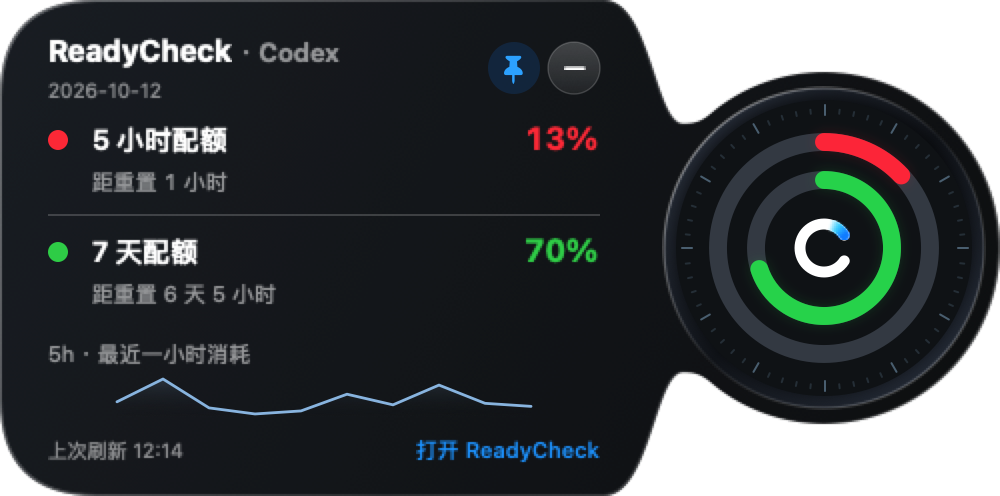

# 0.1.140 黑盒验收

[English](QA.md) · [需求](PLAN.zh-CN.md) · [版本索引](../../VERSIONS.md)

状态：0.1.140已本地安装并于2026年10月12日完成检查；账号恢复完成，实际额度恢复后继续双平台公开发布准备。

[悬停预览态](assets/pin-preview-demo.png)。实际SwiftUI组件使用合成观测值，不是实时账号额度。

| 需求 | 结果与证据 |
| --- | --- |
| 提示用途 | 安装版钉按钮的辅助功能Help已读到中文鼠标移开行为，明确“不是窗口置顶”。移除容器通用提示覆盖，表盘及按钮各自拥有提示。英文文案及原生布局也已检查。工具读数验证提示配置，不量化系统显示延迟。 |
| 持续反馈 | 安装版点击后按钮仍在，首次变为“取消保持详情展开”/“已保持展开”及蓝色实心钉；再点恢复“保持详情展开”/“悬停预览”及空心钉。标题仍单行。 |
| 切换/焦点 | 新测试验证预览→固定→预览、取消后移开收起、在外部取消及拖动/收起时的保护。原生控制器测试验证键盘资格双向变化。保留Esc/外部/Space及原计时逻辑。 |
| 安装/数据 | 最终签名应用已安装，沙箱外严格签名验证通过，可执行摘要与本地构建产物一致。系统钥匙串验证后，手动刷新已返回有效OAuth额度，真实数据下的钉按钮Help和状态切换也已复查。保存凭据未删除。Windows仅同步版本。 |

已完成：持续按钮、状态反馈、两态提示、切换/焦点逻辑、本地安装及账号恢复。部分完成：系统提示显示延迟/主观手感。没有新增账号/通知功能，也未重新验收物理刘海/多显示器。

全量270项Swift测试通过，无跳过/失败。开启`allowsToolTipsWhenApplicationIsInactive`后，13项相关交互/原生测试通过，包含窗口属性回归断言；最终安装版按钮Help和状态变化也已复查。版本一致性、修改文档链接、`git diff --check`及新增文本敏感检查通过。命令：`swift test --build-system native --scratch-path <临时目录>`、`scripts/check_release_consistency.sh`、`scripts/package_app.sh`、`codesign --verify --deep --strict`。

发布范围：新构建0.1.140 DMG和Windows ZIP、净化公开源码、tag及GitHub Release，并核对远端latest、下载链接及资产摘要。稳定预览签名并非Developer ID公证。Windows实机运行仍为验收边界，打包时运行自动化检查。

安装包检查：两个0.1.140产物均成功重新构建。只读挂载DMG确认应用版本0.1.140，沿用原签名身份且深度严格签名校验通过。Windows ZIP完整性及ASAR版本检查通过，20个条目的应用归档未夹带开发/内部文件。打包时OAuth、刷新、历史、提醒、用量及UI自动检查通过。产物目录仅含当前DMG与Windows ZIP。

公开快照验证：执行270项Swift测试，无失败；其中原生固定窗口尺寸测试因后台会话无法保留键盘焦点跳过，单独重试仍受同一限制。该行为已有前述开发工作区测试与安装版真实交互证据。最终公开快照双平台安装包也通过上述DMG挂载及ZIP检查。
