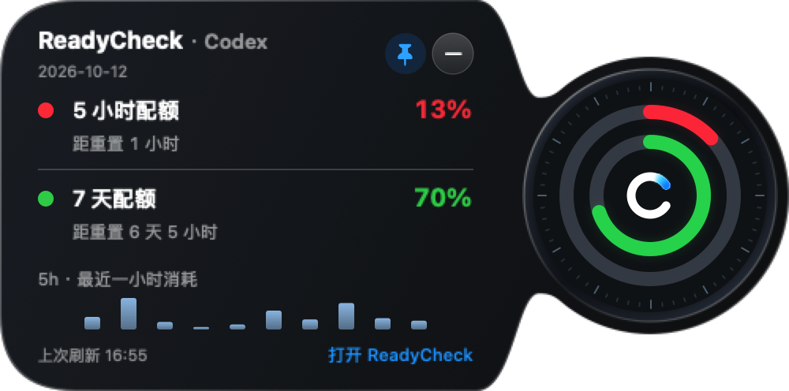

# 0.1.141 黑盒验收

[English](QA.md) · [需求](PLAN.zh-CN.md) · [版本索引](../../VERSIONS.md)

状态：2026年10月12日已完成本机安装与验收，已授权完整公开发布准备。

[英文渲染](assets/consumption-bars-en-demo.png) · [零值刻度](assets/zero-bars-demo.png) · [缺失位置](assets/missing-bars-demo.png)。截图为实际SwiftUI组件及合成观测值，不是实时账号读数。

| 需求 | 结果与证据 |
| --- | --- |
| 单根柱 | 三项几何测试验证每个有观测的位置一根柱、缺失位置不挤占时间轴、柱高比例及12个位置的间距；原生中英文渲染已检查。 |
| 零/未知 | 零值用暗色短刻度，缺失/无效数据留空。原有三项聚合测试通过，未修改数据存储或聚合。安装版中文辅助功能Help已读到五分钟、单位、零及未知的说明；英文源码和渲染已检查。 |
| 安装/布局 | 原应用路径更新为0.1.141，沿用稳定预览签名；严格验证通过，可执行摘要与暂存构建一致。用户完成钥匙串验证后，返回新鲜且已验证的OAuth额度。真实贴边气泡展开显示单柱、完整标题/倒计时及原表盘和固定按钮；展开尺寸仍为500 × 248点。 |

验证：六项聚合/绘图相关测试通过；全量执行270项Swift测试，无失败，1项跳过：Mac锁屏期间原生固定窗口尺寸测试无法保持前台焦点。未修改该行为，已有此前通过的证据，解锁后安装版真实浮窗也已检查。版本一致性、修改文档链接、空白及新增文本敏感检查通过。命令：`swift test --build-system native --scratch-path <临时目录>`、`scripts/check_release_consistency.sh`、`scripts/package_app.sh`、`codesign --verify --deep --strict`。

已完成：macOS柱状图、零/未知区分、中英文提示、匿名原生渲染及安装版视觉验收。Windows仅同步版本信息，没有行为变化及新增实机验收；无待完成的产品修改。现已授权0.1.141公开DMG/ZIP、tag及Release，按标准发布流程验证最终产物及远端状态。签名构建先转移到文件提供器管理的源码目录之外再安装，避免Finder元数据影响严格签名校验；签名身份和保存凭据均保留。

本地安装包检查：使用标准脚本和Node 24成功重新构建0.1.141 DMG及Windows ZIP；挂载DMG内应用版本0.1.141，稳定签名严格验证通过；ZIP完整性及Windows打包自动检查通过。上传前继续校验公开快照最终产物。

最终公开快照验证：全量270项Swift测试通过，无跳过/失败。新DMG挂载后版本及签名校验通过；Windows打包自动检查、ZIP完整性和产物目录检查通过。

远端发布已验证：公开main及注释tag对应7a1c2344d2ed4fd39455395ec35efe982ce715c1，GitHub latest为v0.1.141且只有两个上传完成的安装包。两个下载包均匹配GitHub SHA-256，DMG内版本／签名及Windows ZIP／ASAR版本／内容检查通过。Windows上传工作流38232211864成功。[Release](https://github.com/whnnick/readycheck/releases/tag/v0.1.141)。
