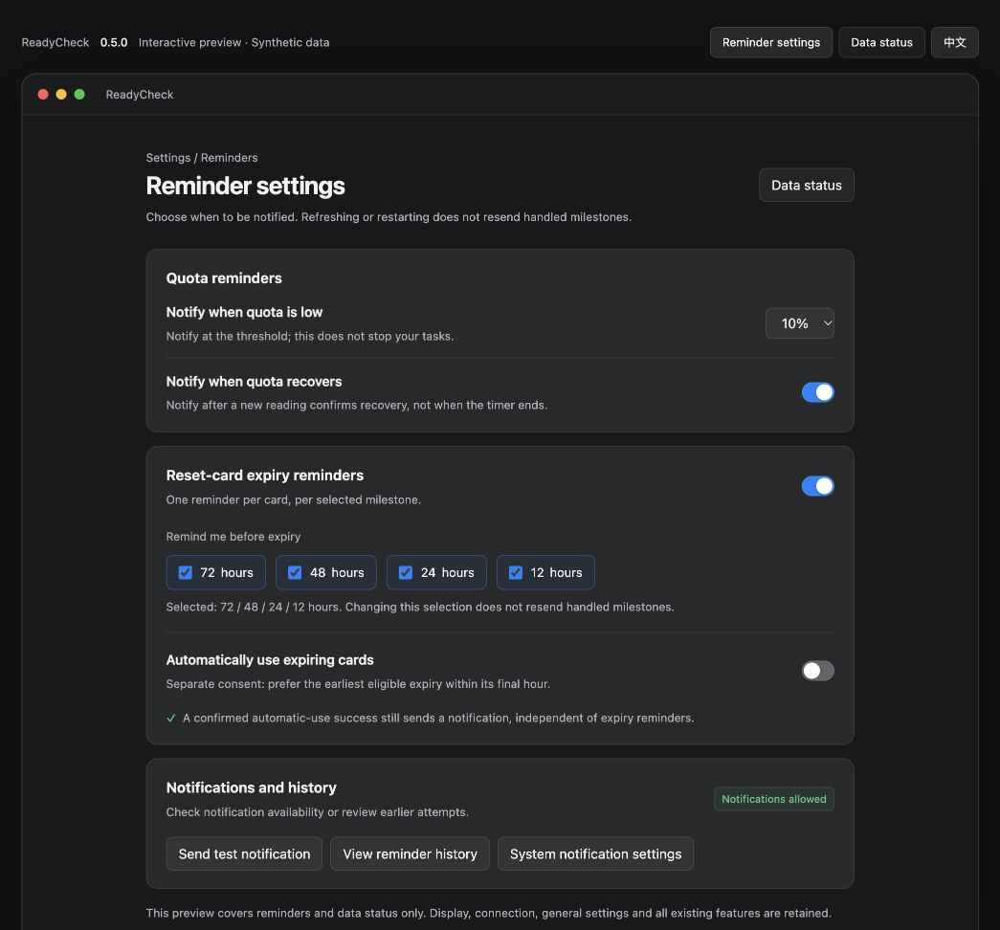
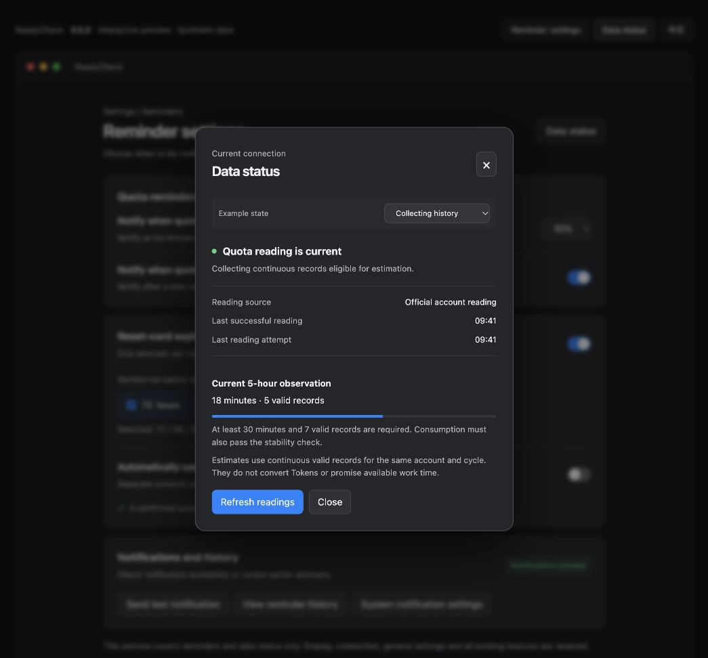

# 0.5.0 interaction preview

[中文](README.zh-CN.md) · [Plan](../PLAN.md) · [Checks](../QA.md)

Preview version:0.5.0-preview.1. Open`index.html` directly or run from the project root:

```sh
python3 -m http.server 4334 --bind 127.0.0.1 --directory docs/versions/0.5.0/prototype
```

Visit`http://127.0.0.1:4334/`. Top controls switch reminder settings/data status and language. The dialog offers six synthetic states; the page footer can fail the next milestone save. Escape closes dialogs. Reload restores sample defaults; no installed preferences are persisted.

Only the two changed surfaces are represented, not the complete app navigation. Automatic use starts Off in the example, independent of the installed application's real preference. Top tabs, scenario selector and failure checkbox are review tools, not proposed native controls. The native system-notification-settings entry remains.




