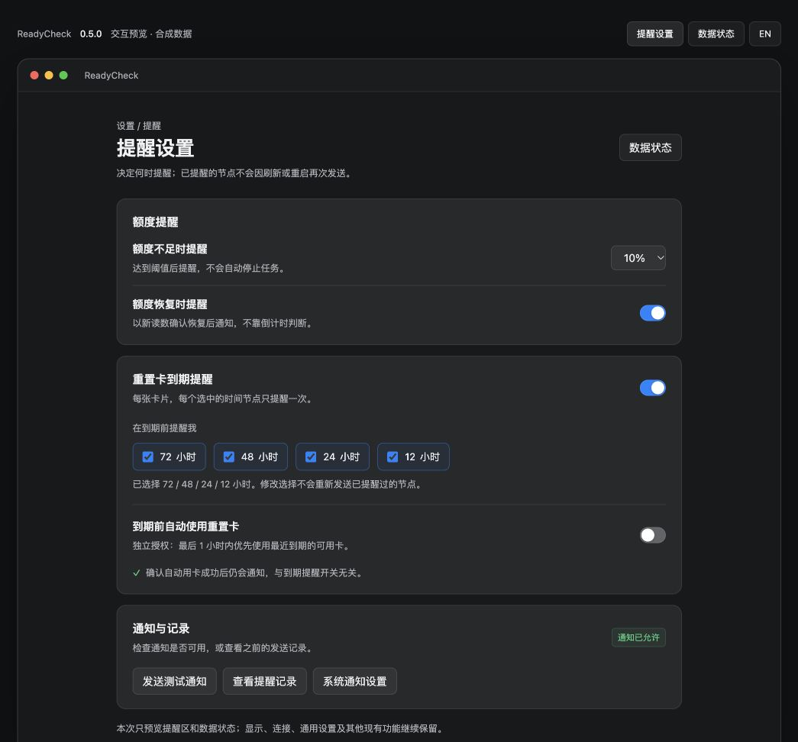
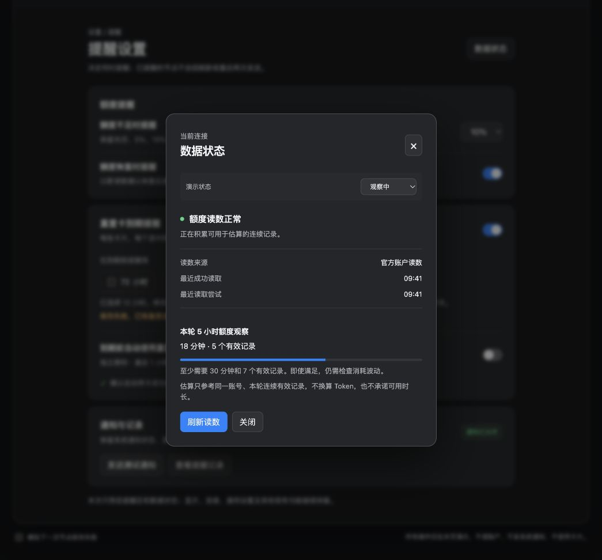

# 0.5.0 交互预览

[English](README.md) · [计划](../PLAN.zh-CN.md) · [验收](../QA.zh-CN.md)

预览版本：0.5.0-preview.1。打开`index.html`即可使用，也可从项目根目录运行：

```sh
python3 -m http.server 4334 --bind 127.0.0.1 --directory docs/versions/0.5.0/prototype
```

浏览器访问`http://127.0.0.1:4334/`。顶部切换提醒设置／数据状态和中英文；弹窗内切换六种合成状态；页面底部可模拟一次节点保存失败。关闭弹窗支持Esc。页面刷新恢复示例默认值，不持久化到本机偏好。

只展示本次两处设计，不代表完整应用导航。自动用卡示例默认关闭，与已安装应用的真实开关无关。顶部页签、情景选择、底部失败开关仅为设计审阅工具，正式界面不添加它们。正式版本保留原系统通知设置入口。




